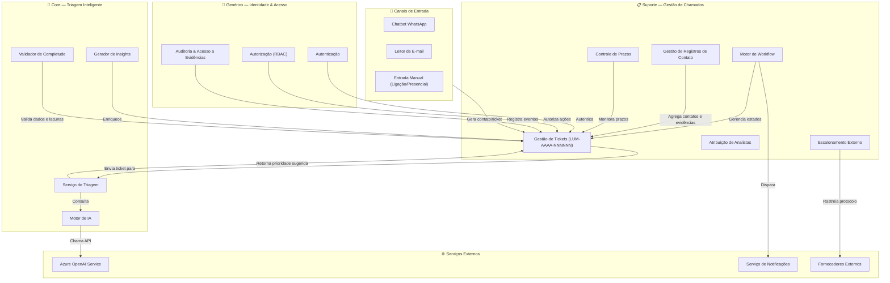
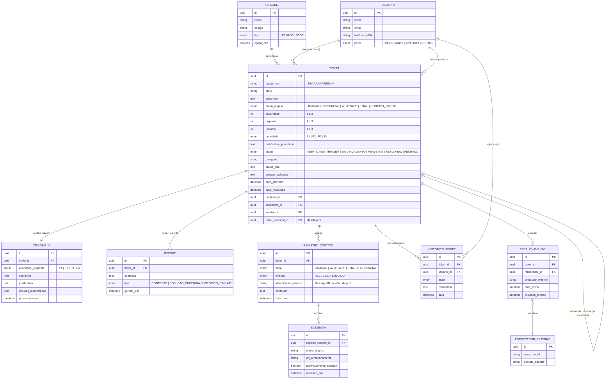

# 🔍 Análise de Domínio — AvanDesk-AI

## 1. Visão Geral do Domínio

O **AvanDesk-AI** opera no domínio de **Gestão de Suporte Técnico (IT Service Management — ITSM)**, atendendo especificamente à operação de suporte e infraestrutura de TI da **Rede Lúmen Diagnósticos**.

### Contexto do Cliente
* **Escala:** 14 unidades físicas distribuídas em Pernambuco (sendo **duas unidades operando 24 horas**).
* **Corpo Colaborador:** ~900 profissionais (recepcionistas, enfermeiros, técnicos de laboratório, médicos e gestores).
* **Equipe de TI:** Time enxuto de 7 analistas de suporte (com atendimento remoto e deslocamento presencial volante).

O problema central atacado é:

> Chamados abertos de forma fragmentada (WhatsApp, ligações, e-mails, conversas de corredor e planilhas) e triagens puramente manuais ou subjetivas geram ruído de comunicação, ausência de identificador único, perda de histórico e aumento no tempo de resposta a incidentes críticos na rotina diagnóstica.

### Delimitação de Escopo
O sistema atende a solicitações sobre:
- **Sistemas corporativos:** agendamento, cadastro de pacientes, autorização de convênios e consulta de resultados.
- **Acessos e contas de usuários:** credenciais corporativas e estações compartilhadas.
- **Equipamentos de apoio:** computadores, impressoras de etiquetas de coleta e infraestrutura de rede.
- **Escalonamento para fornecedores externos:** quando a resolução depender de parceiros contratuais de software/hardware.

> [!IMPORTANT]
> **Fica explicitamente fora do escopo:**
> - Atendimento clínico ou assistencial a pacientes.
> - Manutenção de equipamentos médicos laboratoriais usados diretamente nos exames.
> - **Qualquer armazenamento de prontuários ou resultados de exames de pacientes** (restrição mandatória de segurança e LGPD).

---

## 2. Subdomínios

### 2.1 Subdomínio Core — Triagem Inteligente

O diferencial competitivo da plataforma. Responsável por:

- Análise automática da severidade do chamado com IA.
- Sugestão de nível de prioridade com base no impacto relatado e matriz multidimensional.
- Geração de insights contextuais para auxiliar a investigação do analista.
- Validação de completude dos dados inseridos no ticket e identificação de lacunas.

### 2.2 Subdomínio de Suporte — Gestão de Chamados

Funcionalidades operacionais essenciais que sustentam o core:

- Abertura, edição, mesclagem e fechamento de chamados com identificador no padrão `LUM-AAAA-NNNNNN`.
- Fluxo de status (workflow) do ticket e acompanhamento de ciclo de vida.
- Atribuição e reatribuição de chamados a analistas.
- Histórico consolidado de múltiplos contatos e eventos de auditoria.
- Acompanhamento de prazos de atendimento e escalonamento para fornecedores externos.

### 2.3 Subdomínio Genérico — Identidade & Acesso

Capacidades que não são diferencial, mas são necessárias:

- Autenticação e autorização de usuários.
- Gestão de perfis e permissões (RBAC: Solicitante, Analista, Gestor/Liderança).
- Auditoria de ações e logs de visualização de evidências sensíveis.

---

## 3. Glossário Ubíquo (Ubiquitous Language)

| Termo | Definição |
|-------|-----------|
| **Ticket (Chamado)** | Registro formal de um incidente, problema ou solicitação de suporte, com código único `LUM-AAAA-NNNNNN`. |
| **Código do Chamado** | Identificador exclusivo e legível no formato `LUM-AAAA-NNNNNN` (ex.: `LUM-2026-000123`). |
| **Unidade** | Uma das 14 localidades físicas da Rede Lúmen em PE (unidade ambulatorial, 24h ou sede corporativa). |
| **Registro de Contato** | Cada interação recebida (mensagem, ligação, e-mail) relatando um problema, associável a um chamado. |
| **Canal de Origem** | Meio pelo qual o chamado foi aberto: Ligação, Presencial, WhatsApp (chatbot), E-mail ou Contato direto. |
| **Solicitante** | Colaborador da unidade que abre o ticket ou envia mensagem relatando o problema. |
| **Analista** | Profissional de suporte responsável por investigar, triar, arbitrar prioridade e resolver o ticket. |
| **Gestor / Liderança** | Responsável pela equipe ou unidade; monitora métricas agregadas e distribuição de carga. |
| **Triagem** | Processo de avaliação inicial de um ticket para determinar prioridade, categoria e completude dos dados. |
| **Severidade** | Grau de impacto técnico objetivo do incidente no sistema ou equipamento (quão quebrado está). |
| **Urgência** | Medida temporal de quão rápida a resposta precisa ser (ex.: paciente aguardando fisicamente). |
| **Impacto Operacional** | Extensão dos efeitos da falha sobre colaboradores, setores ou unidades da rede. |
| **Prioridade** | Ordem de atendimento derivada da combinação de severidade, urgência e impacto operacional. |
| **SLA (Service Level Agreement)** | Metas de tempo para resposta e resolução (utilizado como referência interna de acompanhamento no MVP). |
| **Categoria** | Classificação temática do ticket (ex.: Sistemas Corporativos, Impressoras, Rede, Acessos). |
| **Causa Raiz** | Motivo real por trás do problema, identificado após investigação técnica. |
| **Evidência** | Anexo técnico (print, foto, log) com tratamento sensível (oculto por padrão com auditoria de acesso). |
| **Mesclagem** | Ação de incorporar um chamado duplicado (secundário) ao chamado principal. |
| **Chamado Principal** | Chamado ativo que concentra contatos, evidências e histórico de chamados mesclados a ele. |
| **Insight Contextual** | Informação gerada pela IA para apoiar a investigação do analista. |
| **Lacuna de Contexto** | Dado essencial ausente no registro do ticket, identificado automaticamente pelo sistema. |
| **Escalonamento Externo** | Encaminhamento do chamado para um fornecedor externo mantendo rastreabilidade do suporte interno. |
| **Fornecedor Externo** | Empresa parceira responsável por sistemas ou equipamentos sob contrato de manutenção. |
| **Resolução** | Registro da solução técnica aplicada e encerramento do chamado. |
| **Base de Conhecimento** | Repositório de soluções documentadas para problemas recorrentes. |

---

## 4. Mapa de Contexto (Context Map)

---

## 5. Entidades de Domínio Principais

---

## 6. Distinções Conceituais Críticas & Matriz de Prioridade

### Distinções Conceituais
| Conceito | Definição no AvanDesk-AI |
|---|---|
| **Solicitação** | Relato inicial bruto feito por um colaborador, antes de qualquer estruturação (equivale ao `Registro de Contato`). |
| **Chamado (Ticket)** | Registro formal e rastreável, com código `LUM-AAAA-NNNNNN`, que o suporte acompanha até a conclusão. |
| **Incidente** | Evento não planejado que interrompe ou reduz a qualidade de um serviço de TI (o chamado trata o incidente). |
| **Problema** | Causa raiz subjacente que gera incidentes recorrentes (tratado separadamente para eliminar a causa sistêmica). |
| **Crise** | Mobilização organizacional extraordinária da equipe para responder a falhas catastróficas (não é campo preenchível no chamado). |
| **Severidade** | Medida técnica de quão quebrado está o sistema/equipamento (1-Baixo, 2-Médio, 3-Alto). |
| **Urgência** | Medida temporal de quão rápida a resposta precisa ser (1-Baixo, 2-Médio, 3-Alto). |
| **Impacto Operacional** | Extensão dos efeitos da falha sobre pacientes, colaboradores ou unidades (1-Baixo, 2-Médio, 3-Alto). |
| **Prioridade** | Resultado da combinação entre Severidade, Urgência e Impacto, arbitrada pelo analista com auxílio da IA. |

### Matriz de Prioridade 3D
| Critério | 1 — Baixo | 2 — Médio | 3 — Alto |
|---|---|---|---|
| **Severidade** | Funcionamento degradado, com contorno operacional. | Funcionalidade indisponível sem contorno, resto opera. | Sistema ou equipamento totalmente inoperante. |
| **Urgência** | Pode aguardar; nenhum atendimento a paciente em curso. | Afeta expediente, sem paciente aguardando no momento. | Paciente aguardando ou exame interrompido agora. |
| **Impacto** | Apenas um colaborador isolado. | Um setor ou departamento de uma unidade. | Uma unidade inteira ou múltiplas unidades atingidas. |

---

## 7. Atores e Responsabilidades

| Ator | Responsabilidades no Domínio | NÃO é responsável por |
|---|---|---|
| **Solicitante** | Relatar problemas pelo canal disponível; fornecer dados mínimos da solicitação e unidade. | Classificar tecnicamente o problema ou arbitrar prioridade final. |
| **Gestor de Unidade** | Comunicar impacto percebido localmente; escalar demandas operacionais da unidade. | Definir a prioridade oficial do chamado no sistema. |
| **Analista de Suporte** | Registrar, triar, arbitrar prioridade, vincular relatos duplicados, investigar, resolver ou escalar. | Responder por manutenção física de equipamentos médicos ou suporte clínico. |
| **Sistema (IA & Adaptadores)** | Coletar contatos, criar tickets, sugerir prioridade, identificar lacunas, gerar insights e notificar. | Tomar decisões finais de prioridade sem supervisão ou encerrar chamados autonomamente. |
| **Fornecedor Externo** | Atender incidentes contratuais de sistemas/equipamentos sob sua alçada e reportar ao suporte interno. | Atender diretamente o colaborador da unidade ou priorizar fila interna da Lúmen. |
| **Liderança de TI** | Acompanhar métricas consolidadas, definir políticas de segurança e prioridades de melhoria técnica. | Atendimento operacional individual de chamados rotineiros. |

---

## 8. Regras de Negócio Principais

| ID | Regra | Contexto / Origem |
|----|-------|-------------------|
| **RN-01** | Todo ticket deve ter no mínimo: título, descrição, unidade e categoria preenchidos antes de ser submetido. | Validação estrutural do chamado. |
| **RN-02** | A triagem automática deve ser executada imediatamente após a criação do ticket pelo motor de IA. | Core da Triagem Inteligente. |
| **RN-03** | A prioridade sugerida pela IA pode ser aceita ou ajustada pelo analista (com justificativa obrigatória em caso de divergência). | Supervisão humana e controle da fila. |
| **RN-04** | Lacunas de contexto identificadas devem ser comunicadas ao solicitante para complementação guiada. | Redução de vaivém de mensagens. |
| **RN-05** | Prazos operacionais de atendimento são calculados com base na prioridade do chamado. | Referência interna de acompanhamento. |
| **RN-06** | Escalonamento deve ocorrer quando prazos estiverem em risco ou quando houver dependência de fornecedor externo. | Eficiência no atendimento. |
| **RN-07** | Toda resolução deve documentar solução aplicada e, quando identificada, a causa raiz para histórico e base de conhecimento. | Distinção entre incidente e problema. |
| **RN-08** | O sistema deve manter rastreabilidade completa (auditoria) de todas as mudanças de estado, atribuições e eventos do ticket. | Rastreabilidade do suporte. |
| **RN-09** | A plataforma **não deve armazenar resultados de exames nem dados clínicos completos** de pacientes. | Exigência mandatória da direção e LGPD. |
| **RN-10** | Deve ser possível registrar chamados a partir dos canais existentes (Ligação, Presencial, WhatsApp e E-mail), sem exigir migração para canal único. | Preservação da agilidade nas unidades. |
| **RN-11** | Múltiplos relatos e registros de contato sobre o mesmo problema devem poder ser associados a um único ticket. | Agrupamento de contatos duplicados. |
| **RN-12** | Evidências anexadas permanecem ocultas por padrão; cada visualização gera log de auditoria e a Liderança não tem acesso a elas. | Proteção de dados potencialmente sensíveis. |
| **RN-13** | Chamados dependentes de fornecedores externos devem ser escalados com protocolo mantendo o acompanhamento ativo pelo suporte interno. | Não desresponsabilizar o suporte perante as unidades. |
| **RN-14** | Na mesclagem, o ticket secundário vai para `Mesclado` e referencia o principal, cujos contatos e anexos são consolidados. | Tratamento de chamados repetidos. |
| **RN-15** | Registros de contato nunca são excluídos da base de dados; podem apenas ser vinculados ou movidos com auditoria. | Rastreabilidade de mensagens. |
| **RN-16** | Respostas automáticas de e-mail (`Auto-Submitted`) devem ser ignoradas, sem criar tickets. | Prevenção de loops de caixas de correio. |
| **RN-17** | Mensagens externas são processadas com garantia de idempotência pelo `Message-ID` ou ID do WhatsApp. | Prevenção de duplicidades por retry de canais. |
| **RN-18** | Mensagens de voz recebidas no WhatsApp não são transcritas no MVP; o chatbot orienta descrição em texto. | Mitigação de risco LGPD em áudio bruto. |
| **RN-19** | O solicitante é identificado por telefone no formato E.164 ou e-mail corporativo. | Identificação padronizada. |
| **RN-20** | A comunicação de status com o solicitante ocorre preferencialmente pelo canal de origem do chamado. | Agilidade e comodidade para a ponta. |
| **RN-21** | Um chamado resolvido pode ser reaberto pelo solicitante ao contestar a solução dentro do prazo de 7 dias. | Fechamento verificado pelo usuário. |

---

## 9. Casos de Uso Iniciais (UC01 a UC10)

| ID | Caso de Uso | Descrição |
|---|---|---|
| **UC01** | Registrar chamado manual | Registro pelo analista a partir de ligação telefônica ou contato presencial na unidade. |
| **UC02** | Abrir chamado via WhatsApp | Chatbot coleta identificação, unidade, relato e anexos, abrindo o ticket estruturado. |
| **UC03** | Abrir chamado via E-mail | Leitor de e-mail processa mensagens da caixa do suporte e gera o ticket correspondente. |
| **UC04** | Identificar relatos duplicados | Analista associa múltiplos registros de contato ao mesmo chamado já existente. |
| **UC05** | Mesclar chamados duplicados | Incorporação de um ticket duplicado a outro principal com consolidação de histórico. |
| **UC06** | Triar por prioridade e IA | Analista avalia sugestão da IA e Matriz 3D (Severidade + Urgência + Impacto). |
| **UC07** | Acompanhar até resolução | Investigação técnica, registro de solução aplicada e causa raiz da falha. |
| **UC08** | Painel operacional e métricas | Liderança visualiza tickets em aberto, responsáveis e dados agregados por unidade. |
| **UC09** | Escalar para fornecedor externo | Registro de protocolo de parceiro externo mantendo rastreabilidade interna. |
| **UC10** | Notificar pelo canal de origem | Sistema envia avisos de status ao colaborador pelo WhatsApp ou e-mail de origem. |
