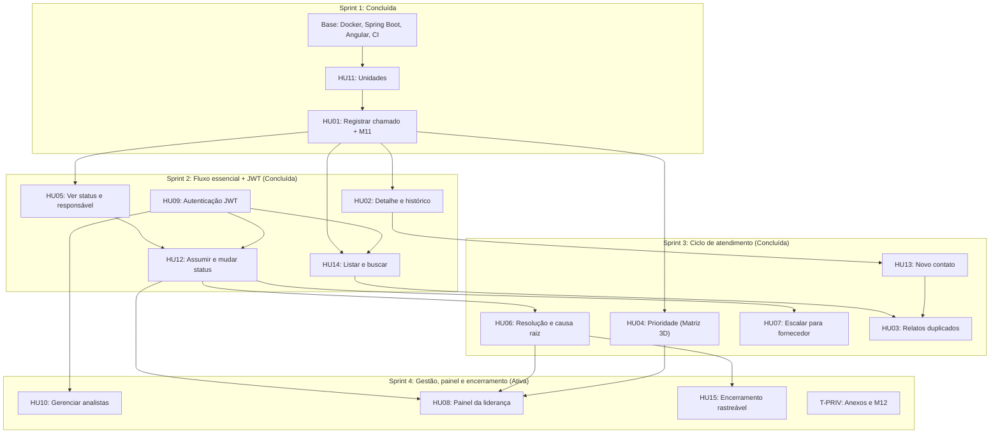

# Backlog Geral do MVP — Nexo

> **Data de atualização:** 25/11/2026  
> **Status geral:** Sprints 1, 2 e 3 concluídas ✅ · Sprint 4 (Gestão de equipe, painel e encerramento) ativa 🎯 com HU08 em andamento e HU15 em code review · Sprint 5 (pós-MVP e evoluções, HU16 a HU26) em andamento parcial  
> **Referência oficial:** [Histórias de Usuário](./04-historias-de-usuario-Nexo.md), [Requisitos Funcionais](./02-requisitos-funcionais.md), [Análise de Domínio](./01-analise-de-dominio-Nexo.md) e Seção 9 do Documento do MVP (Métricas e Instrumentação).

> [!NOTE]
> Cada HU abaixo está no formato de **cartão do Trello**: história, regras de negócio, critérios de aceite, tarefas técnicas por camada e métricas relacionadas. As antigas "Levas" foram reorganizadas em **Sprints** (Leva 0 + Leva 1 = Sprint 1).

---

## 1. Visão Executiva

```
Total: 26 HUs (15 do MVP + 11 pós-MVP e evoluções) + 2 trilhas transversais (Privacidade/LGPD e Qualidade 9.3)

Sprint 1 — Fundações & Entrada ........................ CONCLUÍDA ✅
Sprint 2 — Fluxo essencial + JWT (Login, Fila, Detalhe, Atribuição)  CONCLUÍDA ✅
Sprint 3 — Triagem, Resolução, Fornecedor, Duplicidade  CONCLUÍDA ✅
Sprint 4 — Gestão de Equipe, Painel & Encerramento .... ATIVA 🎯
Sprint 5 - Pós-MVP e evoluções (HU16 a HU26) .......... EM ANDAMENTO PARCIAL 🚧
```

| Sprint | HUs | Objetivo de negócio |
| :--- | :--- | :--- |
| **1** ✅ | HU11, HU01 (+ base técnica) | Registrar o primeiro chamado real no PostgreSQL com eventos imutáveis, datas UTC e telemetria M11. |
| **2** ✅ | HU09, HU14, HU02, HU05, HU12 | O cliente ver o "coração" do sistema com autenticação real: login JWT → chamado na fila → abrir detalhe → assumir com autor real → mudar de status, tudo com histórico auditável. |
| **3** ✅ | HU04, HU06, HU07, HU13, HU03 | Fechar o ciclo de atendimento: priorizar, resolver, escalar para fornecedor, registrar novos contatos e tratar duplicidade. |
| **4** 🎯 | HU10, HU08, HU15, T-PRIV, QA final | Gestão de equipe de analistas, painel da liderança, encerramento rastreável, governança LGPD e homologação. |
| **5** 🚧 | HU16 a HU26 | Evoluções pós-MVP: notificações por e-mail, conta e módulo web do solicitante, reatribuição auditada, anexos seguros, matriz 3D na abertura, métricas e BI, tempo real e cookies HttpOnly. |

### Decisão de priorização (Tech Lead — 27/10/2026)

A autenticação JWT (HU09) foi integrada à **Sprint 2** (junto com o fluxo essencial). Motivo técnico e de negócio:

1. **Identidade real nos eventos (Seção 9.5):** as métricas M01–M08 e a imutabilidade do histórico exigem que o **autor** de cada evento (`CHAMADO_ATRIBUIDO`, `STATUS_ALTERADO`) seja o analista autenticado real, eliminando a dependência do usuário temporário compartilhado (`admin`).
2. **Operações centradas no usuário:** o filtro "Meus chamados" (HU14) e a ação de "Assumir chamado" (HU12) precisam saber quem é o usuário logado para atribuir a responsabilidade diretamente a ele via token.
3. **Frontend já adiantado:** a tela de login (`features/auth/login`) e o interceptor Bearer já foram implementados e testados no front; a meta agora é fechar o endpoint e o filtro de segurança no backend.

> [!TIP]
> **Benefício para a coleta da Seção 9:** Com a HU09 na Sprint 2, os eventos gerados já nascem com o `autor_id` legítimo de cada analista do squad (Sarah, Luiz, Elis, Pedro, etc.), permitindo que validações e a coleta oficial de métricas (M02, M03, M11) já comecem com dados íntegros e auditáveis.

### Matriz de Papéis no Squad

| Membro | Papel | Foco no Backlog |
| :--- | :--- | :--- |
| **Luiz Henrique** | Tech Lead / Fullstack | Arquitetura, contratos OpenAPI, governança técnica e revisões |
| **Elis Tenório** | Backend & Banco de Dados | Migrations Flyway, regras de domínio e APIs Spring Boot |
| **Pedro Vinicius** | Frontend | Componentes Angular 22, formulários reativos, telas e Vitest |
| **Aguinaldo Anselmo** | Fullstack / Integração | Integração front/back e fluxos ponta a ponta |
| **Marcos Fraga** | QA, DevOps & Qualidade | CI/CD, automação de testes da Seção 9.3 e cenários de teste |
| **Sarah Cyrne** | Product & UX Lead | Escopo, regras de negócio, UX, LGPD e condução da coleta |

---

## 2. Mapa de Dependências por Sprint



> [!NOTE]
> Com a HU09 na Sprint 2, a autenticação JWT fornece a identidade real do analista para a fila ("Meus chamados" - HU14) e para assumir chamados (HU12). A HU10 (CRUD administrativo de analistas) permanece na Sprint 4, utilizando inicialmente os usuários provisionados no seed de desenvolvimento (`R__dados_dev.sql`).

---

## 3. Sprint 1 — Fundações & Entrada [CONCLUÍDA ✅]

### Base técnica

| ID | Entrega | Responsável | Entregáveis |
| :--- | :--- | :---: | :--- |
| **L0-01** | Docker Compose com PostgreSQL 16 (porta 5433) | Luiz | `docker-compose.yml`, `.env.example` |
| **L0-02** | Spring Boot 4.0.2, Java 21, Flyway, Bean Validation | Luiz | `backend/pom.xml`, `application.yml` |
| **L0-03** | Angular 22 com Tailwind CSS v4 e estrutura modular | Luiz | `frontend/package.json`, `styles.css` |
| **L0-04** | Pipeline de build e testes no GitHub Actions | Marcos / Luiz | `.github/workflows/ci.yml` |
| **L0-05** | Contrato OpenAPI inicial e envelope `ApiResponse` | Luiz | `docs/openapi-mvp.yaml`, `ApiResponse.java` |
| **L0-06** | Correção de 16 vulnerabilidades do frontend (`npm audit` = 0) | Luiz | PR #18 (`overrides` do Vite) |

### 🏷️ [HU11] Cadastrar e gerenciar unidades — ✅ Concluído

- **Responsáveis:** Elis (BE), Pedro / Luiz (FE) · **RF:** RF-024 · **Métrica:** base de M04 (por unidade)

**História:** Como liderança de TI, quero manter o cadastro das unidades da Rede Lúmen, para que todo chamado seja associado a uma unidade válida.

**Critérios de aceite**
- [x] Cadastrar unidade com nome e identificação única.
- [x] Editar e desativar unidades (desativação lógica, `ativo = false`).
- [x] Unidades desativadas não aparecem na abertura de novos chamados.
- [x] Chamados já registrados mantêm a associação com a unidade desativada.

**Tarefas técnicas**
- [x] **[BD]** `V2__cria_tabela_unidades.sql` com `identificacao` UNIQUE.
- [x] **[BE]** `UnidadeService` / `UnidadeController` (`GET`, `POST`, `PUT`, `PATCH /{id}/desativar`).
- [x] **[FE]** Tela de gestão em `features/admin/unidades/`.

### 🏷️ [HU01] Registrar um chamado + instrumentação 9.5 — ✅ Concluído

- **Responsáveis:** Elis (BE), Pedro (FE), Luiz (arquitetura) · **RF:** RF-001, RF-002, RF-008 · **Métricas:** M09 (canal), M11 (tempo de registro)

**História:** Como analista de suporte, quero registrar uma solicitação recebida por um canal existente como um chamado estruturado, para que o problema possa ser acompanhado e rastreado.

**Regras de negócio**
- Unidade, canal de origem, contato do solicitante, descrição (10 a 2000 caracteres) e categoria são obrigatórios.
- Canais aceitos: `LIGACAO`, `PRESENCIAL`, `WHATSAPP`, `EMAIL`.
- Contato com `@` é e-mail (gravado em minúsculas); sem `@` é telefone convertido para E.164. Contato conhecido reaproveita o solicitante (RN13).
- Aviso de LGPD no formulário: não registrar dados clínicos nem resultados de exames (RN01).
- `origem_dado` (`REAL` / `TESTE` / `SIMULADO`) é definido pelo servidor, nunca pelo cliente.

**Critérios de aceite**
- [x] Gera código único `LUM-AAAA-NNNNNN` (sequence no banco).
- [x] Grava em uma única transação: chamado, registro de contato inicial e eventos `CHAMADO_ABERTO` e `REGISTRO_DE_CONTATO_RECEBIDO`.
- [x] Envia `registro_iniciado_em` (abertura da tela) para a métrica M11.
- [x] Selo "MODO SIMULADO" visível quando `useMocks = true`.

**Tarefas técnicas**

| ID | Tarefa | Camada | Responsável | Status |
| :--- | :--- | :---: | :---: | :---: |
| **BE-01** | `V4__cria_chamados_e_registros_contato.sql` com campos da 9.5 (UTC, origem, prioridade sugerida/final, motivo de espera) | BD | Elis | ✅ |
| **BE-02** | `V5__cria_eventos_historico.sql`: tabela append-only com trigger que bloqueia UPDATE/DELETE | BD | Elis | ✅ |
| **BE-03** | `POST /api/v1/chamados` transacional com teste de rollback | BE | Elis | ✅ |
| **FE-01** | Telemetria M11 na tela Novo Chamado | FE | Pedro | ✅ |
| **FE-02** | Aviso LGPD e selo de modo simulado | FE | Pedro | ✅ |
| **FE-03** | Testes Vitest da tela Novo Chamado (24 testes) | FE | Pedro | ✅ |
| **INT-01** | Integração ponta a ponta (front real → backend dev) e validação da M11 via SQL | Integração | Aguinaldo / Luiz | ✅ |

---

## 4. Sprint 2 — Fluxo Essencial & Autenticação [CONCLUÍDA ✅]

> **Meta da Sprint:** o cliente ver o chamado percorrer o fluxo principal no sistema real com autenticação: **fazer login com sua conta → abrir ou ver o chamado na fila → abrir o detalhe → assumir como responsável → mudar status**, com cada passo registrado no histórico imutável contendo o autor real da ação.

### 🏷️ [HU09] Autenticar no sistema (JWT) — ✅ Concluído

- **Status:** ✅ Concluído · **Responsáveis:** Elis (BE), Pedro (FE), Luiz (Security)
- **RF:** RF-021, RF-022 · **RNF:** RNF-005, RNF-007, RNF-010
- **Métrica:** pré-requisito da coleta oficial e da Seção 9.5 (autor real dos eventos M01–M08)

**História:** Como analista de suporte ou liderança de TI, quero acessar a plataforma com minhas credenciais, para usar apenas as funcionalidades permitidas ao meu perfil.

**Regras de negócio**
- Senha validada contra hash BCrypt da tabela `usuarios`.
- Perfis: `ANALISTA_SUPORTE`, `LIDERANCA_TI` (e `ADMIN`, ver decisões em aberto).
- Token JWT com expiração configurável (padrão de 1 hora, RNF-007).
- Mensagem genérica em credenciais inválidas; usuário inativo não entra.
- `SecurityContext` do Spring preenchido com o e-mail/ID do analista para gravar o `autor_id` legítimo em `eventos_historico`.

**Critérios de aceite**
- [x] Entrar com e-mail e senha e receber token JWT assinado.
- [x] Usuário não autenticado recebe 401 e não acessa rotas de chamados.
- [x] Credenciais inválidas mostram mensagem genérica.
- [x] É possível sair (logout) limpando o armazenamento local.
- [x] Ações de mutação (abrir, assumir, mudar status) registram o autor autenticado no histórico.

**Tarefas técnicas**
- [x] **[BD]** `V3__cria_tabela_usuarios.sql` (BCrypt + perfil) e seed de dev (`R__dados_dev.sql`).
- [x] **[FE]** Tela de login (`features/auth/login`, 5 testes Vitest).
- [x] **[FE]** `TokenStorageService` e `authInterceptor` (anexa o Bearer token quando existir).
- [x] **[BE]** `POST /api/v1/auth/login` e `POST /api/v1/auth/logout` gerando JWT com claims de ID, e-mail e perfil.
- [x] **[BE]** Filtro JWT no Spring Security (`JwtAuthenticationFilter`) substituindo o HTTP Basic temporário.
- [x] **[FE]** Guarda de rotas (`authGuard`) impedindo acesso à fila sem login e logout ativo.
- [x] **[QA]** Testes automatizados de login: sucesso com credenciais válidas e validação de claims do JWT (ID, sub, perfil, expiração de 1h).
- [x] **[QA]** Testes negativos de autenticação: senha errada (401 com mensagem genérica anti-enumeração), usuário inativo (`ativo = false`) e token expirado/adulterado.
- [x] **[QA]** Testes de sessão no frontend: interceptor Bearer, redirecionamento para `/login` no 401 e limpeza do storage no logout.

### 🏷️ [HU14] Listar e buscar chamados — ✅ Concluído

- **Status:** 🔄 Em revisão (BE e FE integrados, PR aberto) · **Responsáveis:** Aguinaldo (BE), Pedro (FE), Marcos (QA)
- **RF:** RF-003 · **Métricas:** M02, apoio a M03

**História:** Como analista de suporte, quero listar e buscar chamados com filtros, para encontrar rapidamente os atendimentos que preciso tratar ou consultar.

**Regras de negócio**
- Listagem paginada (padrão: 20 por página), ordenada do mais recente para o mais antigo (`aberto_em DESC`).
- Filtros combináveis: status, unidade, prioridade e responsável.
- Filtros rápidos: "Meus chamados" e "Sem responsável" (`responsavel_id IS NULL`).
- Busca exata pelo código `LUM-AAAA-NNNNNN`.

**Critérios de aceite**
- [x] A lista exibe código, unidade, status, prioridade e responsável.
- [x] É possível filtrar por status, unidade, prioridade e responsável (na tela: "Somente meus" e "Somente sem responsável"; o seletor de analista depende da HU10).
- [x] É possível buscar pelo identificador único.
- [x] É possível ver só os chamados atribuídos a mim.
- [x] A partir da lista, é possível abrir o detalhe do chamado.

**Tarefas técnicas**
- [x] **[FE]** Tela da fila com filtros e badges (`features/chamados/fila-chamados`, 5 testes Vitest).
- [x] **[BE]** `ChamadoSpecification` (Spring Data JPA) para filtros dinâmicos.
- [x] **[BE]** `GET /api/v1/chamados` com `Pageable` e filtros opcionais (`unidade_id`, `status`, `prioridade`, `responsavel_id`, `codigo`), mais `canal_origem`, `sem_responsavel`, `sem_prioridade`, `meus` (pelo token) e `totais_por_status` para os cartões (`FilaChamadosService`).
- [x] **[BE]** Atualizar `openapi-mvp.yaml` e `06-documentacao-api-mvp.md` com o contrato paginado.
- [x] **[FE]** Ajustar `ChamadoService.listar()` ao formato paginado e desligar o mock da fila (filtros e paginação no servidor, "Somente sem responsável", busca por código, cartões por `totais_por_status`; 15 testes Vitest novos).
- [x] **[QA]** Teste de integração de filtros combinados: status + unidade + prioridade + responsável (interseção correta) (`FilaChamadosIntegracaoTest`).
- [x] **[QA]** Teste do filtro rápido "Meus chamados": assegurar que filtra exatamente pelo ID do analista autenticado no JWT (`FilaChamadosIntegracaoTest`).
- [x] **[QA]** Teste de performance de listagem (RNF-004): carga com 1.000 chamados no banco garantindo tempo de resposta p95 < 1.000 ms (`FilaChamadosPerformanceTest`; medido localmente: 24 ms).
- [x] **[QA]** Teste de paginação e ordenação: validar consistência de `page`, `size` e ordenação `aberto_em DESC` (`FilaChamadosIntegracaoTest`).

### 🏷️ [HU02] Consultar o histórico do chamado — ✅ Concluído

- **Status:** ✅ Concluído · **Responsáveis:** Elis (BE), Pedro / Luiz (FE), Marcos (QA)
- **RF:** RF-004 · **Métrica:** M01 (rastreabilidade)

**História:** Como analista de suporte, quero visualizar o histórico completo de um chamado, para entender o que já aconteceu e continuar o atendimento sem depender de mensagens espalhadas.

**Regras de negócio**
- A linha do tempo vem da tabela `eventos_historico`, em ordem cronológica (`ocorrido_em`).
- Cada evento mostra tipo, data/hora (UTC convertida para o horário local na tela) e autor.
- O histórico é somente leitura: o banco rejeita UPDATE e DELETE.

**Critérios de aceite**
- [x] O histórico reúne os registros de contato associados ao chamado.
- [x] Os acontecimentos relevantes do atendimento aparecem na linha do tempo.
- [x] O responsável atual está visível.
- [x] Um analista que não abriu o chamado consegue entender o histórico.

**Tarefas técnicas**
- [x] **[BD]** `eventos_historico` com trigger de imutabilidade (V5).
- [x] **[FE]** Tela de detalhe com linha do tempo (`features/chamados/detalhe-chamado`, 6 testes Vitest).
- [x] **[BE]** `GET /api/v1/chamados/{id}` retornando dados do chamado, contatos e eventos ordenados.
- [x] **[FE]** Conectar `ChamadoService.buscarPorId()` à API real com adaptador de contrato (`mapearChamadoDetalhe`).
- [x] **[QA]** Teste de integridade da linha do tempo: conferir ordenação cronológica estrita dos eventos e junção correta dos contatos.
- [x] **[QA]** Teste de imutabilidade em banco: validar que tentativa de `UPDATE` ou `DELETE` em `eventos_historico` é abortada pelo trigger.
- [x] **[QA]** Teste de timezone e formatação: validação de conversão de timestamp UTC do banco para o fuso local do navegador do usuário.

### 🏷️ [HU05] Acompanhar status e responsável — ✅ Concluído

- **Status:** ✅ Concluído · **Responsáveis:** Elis (BE), Pedro / Luiz (FE), Marcos (QA)
- **RF:** RF-015 · **Métrica:** M02

**História:** Como analista de suporte, quero visualizar o status e o responsável de cada chamado, para saber quais atendimentos estão em andamento e quem cuida de cada um.

**Regras de negócio**
- Status do domínio: `ABERTO`, `EM_TRIAGEM`, `EM_ATENDIMENTO`, `AGUARDANDO`, `RESOLVIDO`, `REABERTO`, `FECHADO`, `CANCELADO`, `MESCLADO`.
- Sem responsável, a tela mostra "Não atribuído".
- A HU05 trata da **visualização**; a ação de mudar status está na HU12.

**Critérios de aceite**
- [x] Todo chamado exibe seu status atual.
- [x] O analista responsável aparece quando houver.
- [x] O ciclo de vida pode ser acompanhado pelo histórico.

**Tarefas técnicas**
- [x] **[BD]** Constraint `ck_chamados_status` e enum `StatusChamado`.
- [x] **[BE]** Incluir `status` e `responsavel` (id e nome) nos DTOs da listagem e do detalhe.
- [x] **[FE]** Exibir status e responsável com os dados reais da API.
- [x] **[QA]** Teste de renderização de estados: validação de cores, badges e labels para os 9 status possíveis do domínio.
- [x] **[QA]** Teste de visualização de estado "Não atribuído": validar comportamento quando `responsavel_id` é nulo (sem exceptions na UI).

### 🏷️ [HU12] Atribuir responsável e atualizar status — ✅ Concluído

- **Status:** ⏳ A iniciar · **Responsáveis:** Elis / Aguinaldo (BE), Pedro (FE), Marcos (QA)
- **RF:** RF-015, RF-016 · **Métricas:** M02, M03 (TPR/TR)

**História:** Como analista de suporte, quero assumir, atribuir ou reatribuir um chamado e atualizar seu status, para que fique claro quem conduz cada atendimento e em que etapa ele está.

**Regras de negócio**
- Assumir: o chamado passa a ter o usuário atual como responsável.
- Reatribuir: só para analista ativo.
- Mudança de status só por transições válidas do ciclo de vida (ver [Análise de Domínio, §6](./01-analise-de-dominio-Nexo.md)). Ex.: `RESOLVIDO` só volta para `REABERTO`, nunca direto para `EM_TRIAGEM`.
- Ir para `AGUARDANDO` exige motivo: `FORNECEDOR`, `SOLICITANTE` ou `PECA_EQUIPAMENTO` (constraint `ck_chamados_espera`).
- Toda ação grava evento no histórico, na mesma transação, com data UTC e autor (`CHAMADO_ATRIBUIDO`, `CHAMADO_AGUARDANDO`, `RETORNO_RECEBIDO`, etc.).
- A primeira ação do analista sobre o chamado preenche `primeira_resposta_em` (base da M03).

**Critérios de aceite**
- [ ] É possível assumir um chamado para si.
- [ ] É possível reatribuir a outro analista ativo.
- [ ] Só transições válidas são aceitas.
- [ ] Toda atribuição e mudança de status aparece no histórico com data e autor.
- [ ] Transições inválidas são bloqueadas com mensagem explicativa.

**Tarefas técnicas**
- [ ] **[BE]** Máquina de estados no domínio (validação de transições em um único lugar).
- [ ] **[BE]** `PATCH /api/v1/chamados/{id}/responsavel` (assumir/reatribuir).
- [ ] **[BE]** `PATCH /api/v1/chamados/{id}/status` (com motivo de espera quando aplicável).
- [ ] **[BE]** Atualizar contrato OpenAPI e documentação da API.
- [ ] **[FE]** Botões "Assumir", "Reatribuir" e "Alterar status" na tela de detalhe.
- [ ] **[QA]** Teste exaustivo da máquina de estados: testar todas as transições de status válidas e inválidas da matriz do domínio, garantindo `422 Unprocessable Entity` nas ilegais.
- [ ] **[QA]** Teste de obrigatoriedade de motivo de espera: validar rejeição de transição para `AGUARDANDO` sem motivo ou com motivo inválido (`ck_chamados_espera`).
- [ ] **[QA]** Teste de autoria e gravação de evento: validar que assumir/reatribuir grava o evento com `autor_id` extraído do JWT e atualiza `primeira_resposta_em` no primeiro toque (M03).

---

## 5. Sprint 3 — Ciclo de Atendimento [CONCLUÍDA ✅]

### 🏷️ [HU04] Definir a prioridade (Matriz 3D) — ✅ Concluído

- **Responsáveis:** Elis (BE), Pedro (FE), Marcos (QA) · **RF:** RF-009, RF-010 · **Métrica:** M08 (concordância)

**História:** Como analista de suporte, quero avaliar severidade, urgência e impacto operacional, para determinar a prioridade de forma estruturada.

**Regras de negócio**
- Severidade, urgência e impacto operacional avaliados separadamente (1 a 3).
- O sistema calcula a **prioridade sugerida** pela matriz da Análise de Domínio (§3): `ALTA`, `MEDIA` ou `BAIXA`.
- Se o analista escolher uma **prioridade final** diferente, a justificativa é obrigatória (constraint `ck_chamados_justificativa`).
- Solicitante ou gestor não define a prioridade final.

**Critérios de aceite**
- [ ] Severidade e urgência avaliadas separadamente; impacto faz parte da avaliação.
- [ ] A prioridade final resulta desses critérios.
- [ ] Divergência entre sugerida e final exige justificativa.
- [ ] A prioridade fica registrada no chamado e no histórico (`PRIORIDADE_DEFINIDA`).

**Tarefas técnicas**
- [ ] **[BE]** Serviço de cálculo da matriz com testes unitários de todas as combinações.
- [ ] **[BE]** Endpoint de triagem/prioridade.
- [ ] **[FE]** Componente de triagem com prévia da prioridade sugerida.
- [ ] **[QA]** Teste unitário e paramétrico cobrindo as 27 combinações da Matriz 3D (Severidade x Urgência x Impacto).
- [ ] **[QA]** Teste de divergência de prioridade: validar bloqueio sem justificativa e aprovação com justificativa válida (`ck_chamados_justificativa`).
- [ ] **[QA]** Teste de RBAC: assegurar que solicitantes ou perfis não autorizados são bloqueados ao tentar definir prioridade.
- [ ] **[QA]** Teste de telemetria M08: validar cálculo exato da taxa de concordância entre prioridade sugerida e final.

### 🏷️ [HU06] Registrar resolução e causa raiz — ✅ Concluído

- **Responsáveis:** Elis (BE), Pedro (FE), Marcos (QA) · **RF:** RF-012, RF-014 · **Métricas:** M04 (TR), M06 (reabertura)

**História:** Como analista de suporte, quero registrar como o chamado foi resolvido e, quando identificada, sua causa raiz, para manter o conhecimento e reconhecer problemas recorrentes.

**Regras de negócio**
- Resolução obrigatória ao ir para `RESOLVIDO` (constraint `ck_chamados_resolucao`).
- Causa raiz opcional; `possivel_recorrencia` sinaliza problema recorrente.
- Grava `resolvido_em` (UTC) e evento `CHAMADO_RESOLVIDO`.

**Critérios de aceite**
- [ ] É possível registrar a resolução.
- [ ] É possível registrar a causa raiz, sem obrigatoriedade.
- [ ] O histórico permanece após a resolução.
- [ ] É possível distinguir atendimento pontual de causa recorrente.

**Tarefas técnicas**
- [ ] **[BE]** Endpoint de resolução.
- [ ] **[FE]** Formulário de resolução na tela de detalhe.
- [ ] **[QA]** Teste de validação de encerramento: transição para `RESOLVIDO` sem descrição de resolução deve falhar (`ck_chamados_resolucao`).
- [ ] **[QA]** Teste de causa raiz e recorrência: validar gravação correta de `possivel_recorrencia`, data UTC `resolvido_em` e emissão do evento.
- [ ] **[QA]** Teste de ciclo de reabertura: validar cálculo do Tempo de Resolução (M04) e registro para taxa de reabertura (M06).

### 🏷️ [HU07] Escalar chamado para fornecedor externo — ✅ Concluído

- **Responsável:** Aguinaldo (BE/FE), Marcos (QA) · **RF:** RF-017, RF-018 · **Métrica:** M05 (tempo em terceiros)

**História:** Como analista de suporte, quero encaminhar um chamado a um fornecedor externo mantendo o acompanhamento interno, para que o atendimento não perca a rastreabilidade.

**Regras de negócio**
- O chamado vai para `AGUARDANDO` com motivo `FORNECEDOR`; o analista interno continua responsável.
- Registrar fornecedor, data de envio e data de retorno.
- Eventos `CHAMADO_ESCALADO` e `RETORNO_RECEBIDO`.

**Critérios de aceite**
- [ ] É possível indicar que o chamado depende de fornecedor e qual fornecedor recebeu.
- [ ] O histórico anterior continua disponível.
- [ ] O time interno continua identificável como responsável.
- [ ] É possível registrar o retorno e o fim do escalonamento.

**Tarefas técnicas**
- [ ] **[BD]** Nova migration para escalonamentos (fornecedor, envio, retorno).
- [ ] **[BE]** Endpoints de escalar e registrar retorno.
- [ ] **[FE]** Interface de escalonamento na tela de detalhe.
- [ ] **[QA]** Teste de transição de escalonamento: validar status `AGUARDANDO`, motivo `FORNECEDOR` e permanência do analista interno como responsável.
- [ ] **[QA]** Teste de encerramento de escalonamento: validação de data de retorno (`retorno_em >= enviado_em`) e cálculo de desconto de tempo para a métrica M05.

### 🏷️ [HU13] Registrar novo contato em chamado existente — ✅ Concluído

- **Responsáveis:** Elis (BE), Pedro (FE), Marcos (QA) · **RF:** RF-006 · **Métricas:** M09, M01

**História:** Como analista de suporte, quero registrar um novo contato sobre um chamado aberto, para manter as interações concentradas no mesmo atendimento.

**Regras de negócio**
- Registra canal, direção (`RECEBIDO` / `ENVIADO`), data e quem relatou.
- Identificador externo único por canal (RN16, constraint `uq_registros_contato_externo`).
- Proibido incluir dados clínicos ou resultados de exames.

**Critérios de aceite**
- [ ] É possível adicionar um registro de contato a um chamado existente.
- [ ] O registro indica canal, data e quem relatou.
- [ ] O novo contato aparece no histórico.

**Tarefas técnicas**
- [ ] **[BE]** `POST /api/v1/chamados/{id}/contatos` com evento `REGISTRO_DE_CONTATO_RECEBIDO`.
- [ ] **[FE]** Formulário de novo contato na tela de detalhe.
- [ ] **[QA]** Teste dos 4 canais aceitos (`LIGACAO`, `PRESENCIAL`, `WHATSAPP`, `EMAIL`) e direções `RECEBIDO`/`ENVIADO`.
- [ ] **[QA]** Teste de unicidade de identificador externo por canal (RN16 / constraint `uq_registros_contato_externo`).
- [ ] **[QA]** Teste de proteção LGPD (RN01): verificar bloqueio ou alerta para conteúdo sensível clínico nos contatos.

### 🏷️ [HU03] Identificar relatos duplicados ou relacionados — ✅ Concluído

- **Responsável:** Aguinaldo (BE/FE), Marcos (QA) · **RF:** RF-011 · **Métrica:** M07

**História:** Como analista de suporte, quero associar relatos diferentes ao mesmo chamado quando se referem ao mesmo problema, para não tratar um incidente como vários atendimentos.

**Regras de negócio**
- Vincular relato a um chamado (`chamado_original_id` em `registros_contato`) sem apagar o registro original.
- Mesclar chamado duplicado no principal (RN17): status `MESCLADO` com `chamado_principal_id`, nunca apontando para si mesmo.
- Eventos `RELATO_VINCULADO`, `RELATO_DESVINCULADO` e `CHAMADO_MESCLADO`.

**Critérios de aceite**
- [ ] Mais de um registro de contato pode ser associado a um chamado.
- [ ] O analista identifica que relatos estão relacionados.
- [ ] Relatos associados continuam rastreáveis.
- [ ] A associação não apaga o contato original.

**Tarefas técnicas**
- [ ] **[BE]** Operações de vincular relato e mesclar chamado.
- [ ] **[FE]** Busca do chamado principal (usa a HU14) e confirmação da mesclagem.
- [ ] **[QA]** Teste de auto-referência cíclica: bloqueio de tentativa de mesclar um chamado nele mesmo (`chamado_id == chamado_principal_id`).
- [ ] **[QA]** Teste de conservação de contatos: garantir que a mesclagem não remove contatos originais e transiciona status para `MESCLADO`.
- [ ] **[QA]** Teste de evento de mesclagem e auditoria para a métrica M07 (taxa de chamados duplicados).

---

## 6. Sprint 4 — Gestão de Equipe, Painel & Encerramento [ATIVA 🎯]

### 🏷️ [HU10] Gerenciar analistas — ✅ Concluído

- **Status:** 🔄 Em revisão (BE e FE, PR aberto) · **Responsável:** Aguinaldo (BE/FE), Marcos (QA) · **RF:** RF-023

**História:** Como liderança de TI, quero cadastrar, editar e desativar analistas, para controlar quem pode atuar nos chamados.

**Regras de negócio**
- Só `LIDERANCA_TI` altera analistas (`@PreAuthorize`); a listagem atende qualquer usuário autenticado, porque alimenta a atribuição.
- Perfil sempre `ANALISTA_SUPORTE`; e-mail corporativo (`nexo.usuarios.dominios-email`) e único.
- Senha temporária gerada no cadastro e exibida uma única vez.
- Desativação lógica (`ativo = false`) com efeito imediato: o filtro JWT confere a situação no banco a cada requisição.

**Critérios de aceite**
- [x] Cadastrar analista com nome e e-mail (e-mail único); o perfil é sempre `ANALISTA_SUPORTE`.
- [x] Editar dados de um analista.
- [x] Desativar sem apagar o histórico de atuação.
- [x] Analista desativado não acessa o sistema nem recebe novos chamados.

**Tarefas técnicas**
- [x] **[BE]** CRUD de usuários restrito ao perfil autorizado (`UsuarioController` em `/api/v1/analistas`).
- [x] **[BE]** `GET /chamados/totais-por-responsavel` para a coluna "Chamados ativos".
- [x] **[FE]** Tela em `features/admin/analistas/`, com `perfilGuard` na área `/admin` e o menu "Administração" só para a Liderança.
- [x] **[QA]** Teste de RBAC: cadastrar/desativar com `ANALISTA_SUPORTE` recebe `403 Forbidden`; `LIDERANCA_TI` é liberada (`UsuarioControllerTest`).
- [x] **[QA]** Teste de integridade de e-mail único: `409 Conflict` em duplicidade (`UsuarioServiceTest`, `UsuarioControllerTest`).
- [x] **[QA]** Teste de desativação lógica: token de analista inativo não autentica (`JwtAuthenticationFilterTest`) e o cadastro não é apagado (`UsuarioServiceTest`).
- [ ] **[FE]** Seletor de reatribuição no detalhe do chamado usando `GET /analistas?ativo=true` (pendência da HU12).

### 🏷️ [HU08] Visualizar a situação dos chamados (Painel da Liderança) — 🚧 Em andamento

- **Responsáveis:** Elis / Luiz (BE), Pedro (FE), Marcos (QA) · **RF:** RF-026, RF-027, RF-028 · **Métricas:** M01–M12

**História:** Como liderança de TI, quero visualizar chamados em aberto, responsáveis e informações agregadas, para acompanhar o suporte e identificar padrões.

**Regras de negócio**
- Uma consulta por métrica (M01–M12), filtrável por período e unidade.
- Destacar os limiares da Seção 9.7. Ex.: M12 > 0 bloqueia a coleta; M08 > 30% leva a recalibrar a matriz; M11 > 60 s leva a reduzir campos obrigatórios.
- Dados simulados ou de teste não entram nas métricas oficiais (filtro por `origem_dado`).

**Critérios de aceite**
- [ ] Ver chamados em aberto e seus responsáveis.
- [ ] Consultar informações agregadas por unidade.
- [ ] Identificar problemas recorrentes.
- [ ] As informações vêm só dos chamados registrados na plataforma.

**Tarefas técnicas**
- [ ] **[BE]** Consultas agregadas das métricas M01–M12.
- [ ] **[FE]** Dashboard em `features/dashboard/` (pasta ainda vazia).
- [ ] **[QA]** Teste de segregação de dados: validar que consultas de métricas oficiais filtram estritamente `origem_dado = 'REAL'` e descartam `SIMULADO` e `TESTE`.
- [ ] **[QA]** Teste matemático das métricas: validar cálculos de TT, TPR, TR, percentil 90 e taxa de reabertura contra base de dados de controle (oráculo de teste).
- [ ] **[QA]** Teste de filtros agregados por período e unidade hospitalar.

### 🏷️ [HU15] Encerrar chamado com verificação de rastreabilidade — 🔎 Em code review

- **Responsáveis:** Elis (BE), Pedro (FE), Marcos (QA) · **RF:** RF-013, RF-028 · **Métrica:** M01 (métrica principal)

**História:** Como analista de suporte, quero encerrar um chamado resolvido e saber se o registro está completo, para garantir que fique rastreável.

**Critérios de aceite**
- [ ] Só encerra chamado em `RESOLVIDO`.
- [ ] Verifica: problema, unidade, responsável, ao menos um contato, evolução de status e resolução.
- [ ] Indica o que está pendente quando falta algo.
- [ ] Registra o encerramento no histórico (`CHAMADO_FECHADO`) e grava `fechado_em`.
- [ ] Armazena o resultado da verificação para a métrica M01.

**Tarefas técnicas**
- [ ] **[BE]** Verificador de rastreabilidade e endpoint de encerramento.
- [ ] **[FE]** Checklist visual de pendências antes de encerrar.
- [ ] **[QA]** Teste de bloqueio de encerramento incompleto: tentar fechar chamado sem resolução ou sem histórico de transição e validar recusa detalhada.
- [ ] **[QA]** Teste de conformidade M01: validação de gravação do score de rastreabilidade e timestamp `fechado_em` no encerramento aprovado.

### 🏷️ [T-PRIV] Anexos com privacidade e auditoria (LGPD) — 📌 Formalizado como HU21 (pós-MVP)

- **Responsáveis:** Elis (BE), Pedro (FE), Marcos (QA) · **RF:** RF-007, RF-008 · **RNF:** RNF-009 · **Métrica:** M12 (meta zero)

**Objetivo:** Anexos ocultos por padrão, restritos a analistas e com log de cada visualização.

**Critérios de aceite**
- [ ] Anexos não são exibidos automaticamente.
- [ ] Liderança de TI não abre anexos (RN06).
- [ ] Cada visualização grava evento `ANEXO_VISUALIZADO` com autor e data.

**Tarefas técnicas**
- [ ] **[BD]** Migration de anexos.
- [ ] **[BE]** Download com verificação de perfil e gravação do evento.
- [ ] **[FE]** Componente de anexo com bloqueio visual.
- [ ] **[QA]** Teste de barreira de acesso e perfil (RN06): Liderança de TI bloqueada (`403 Forbidden`); analista de suporte autorizado.
- [ ] **[QA]** Teste de auditoria obrigatória: validar inserção do evento `ANEXO_VISUALIZADO` na mesma transação com autor e data UTC a cada visualização/download.
- [ ] **[QA]** Teste de segurança de upload: bloqueio de extensões maliciosas (.exe, .bat, .sh) e restrição aos tipos permitidos (PDF, PNG, JPG).

> [!NOTE]
> Decisão tomada: esta trilha foi formalizada como HU21 (upload e visualização segura de anexos), na Sprint 5 (pós-MVP). O cartão [SEG/LGPD] do Sprint Backlog no Trello cobre a gestão segura de anexos e o log de auditoria (M12).

---

## 6.1 Sprint 5: Pós-MVP e Evoluções (HU16 a HU26)

> As tarefas técnicas por camada (BD, BE, FE e QA) de cada história estão no documento [Histórias de Usuário](./04-historias-de-usuario-Nexo.md), seção 5. Estado de cada cartão conforme o Trello em 25/11/2026.

### 🏷️ [HU16] Obrigatoriedade de e-mail e notificações automáticas de status

- **Situação:** Pós-MVP · **Prazo:** 26/11/2026

**História:** Como solicitante de um chamado, quero receber e-mails automáticos com o código do chamado e as mudanças de status, para acompanhar o atendimento sem precisar consultar a equipe de suporte.

**Critérios de aceite**
- [ ] O campo de e-mail do solicitante passa a ser obrigatório e validado (formato RFC e conversão para minúsculas) na criação do chamado.
- [ ] Ao criar o chamado, o solicitante recebe um e-mail com o código único (`LUM-AAAA-NNNNNN`) e resumo da solicitação.
- [ ] A cada mudança de status relevante, um e-mail assíncrono é disparado informando o status anterior, o novo status e orientações cabíveis.
- [ ] Falhas no servidor de e-mail (SMTP indisponível) **não** devem cancelar (dar rollback) na mudança de status do chamado, devendo registrar log/tentativa de reenvio.
- [ ] Todo envio bem-sucedido grava o evento `NOTIFICACAO_ENVIADA` em `eventos_historico`.

### 🏷️ [HU17] Cadastro de conta do Solicitante e verificação por e-mail

- **Situação:** Pós-MVP · **Prazo:** 26/11/2026

**História:** Como colaborador de uma unidade (`SOLICITANTE`), quero criar minha conta informando meu e-mail (seja corporativo `@lumen` ou pessoal como Gmail/Outlook, conforme política configurada) e confirmá-lo por link/código de verificação, para acessar meus chamados via Web com segurança e ter meu histórico vinculado automaticamente.

> **Política Flexível de Domínio de E-mail (`@lumen` vs. E-mail Aberto):**
> No contexto hospitalar, recepcionistas ou técnicos de turno muitas vezes não possuem caixa de e-mail corporativa individual (usando Gmail/Outlook), enquanto para Analistas (`HU10`) exigimos domínio corporativo. Por isso, implementamos uma **propriedade configurável** (`nexo.solicitantes.restringir-dominio-email: false` por padrão, com whitelist `nexo.solicitantes.dominios-permitidos: "@lumen.com.br"`). Assim, hoje aceitamos qualquer provedor válido mediante verificação de propriedade do e-mail (Token/OTP), mas podemos ativar a trava exclusiva `@lumen` via variável de ambiente sem alterar código!

**Critérios de aceite**
- [ ] Deve existir o perfil `SOLICITANTE` na estrutura de controle de acesso.
- [ ] O auto-cadastro exige nome, e-mail válido (aceitando qualquer provedor por padrão ou restringindo a `@lumen` via flag de configuração), unidade padrão e senha forte.
- [ ] A conta nasce com status `PENDENTE_VERIFICACAO` e não permite login completo até a confirmação do token enviado por e-mail (expiração de 24h).
- [ ] Ao confirmar o e-mail, chamados anteriores abertos pelo Analista com aquele mesmo endereço de e-mail são vinculados automaticamente ao `solicitante_id` do usuário.

### 🏷️ [HU18] Módulo Web do Solicitante (/solicitante/**) e Chat Assíncrono em Texto (via HTTP)

- **Situação:** Pós-MVP · **Prazo:** 03/12/2026

**História:** Como solicitante autenticado na aplicação Web (desktop ou navegador mobile), quero acessar meu módulo dedicado ("Meus Chamados") e conversar por mensagens de texto com o analista na thread do chamado, para tirar dúvidas, acrescentar contexto textual ao problema e acompanhar a resolução sem abrir tickets duplicados.

> **Decisão de Arquitetura Pragmática (100% Web + Chat Texto via HTTP REST):**
> - **Módulo e Namespace Semântico:** Isolamos as rotas de API e Frontend do solicitante sob `/api/v1/solicitante/**` (no Backend) e `/solicitante/**` (módulo lazy-loaded no Angular), facilitando regras de segurança (`hasRole('SOLICITANTE')`) e separação de contexto.
> - **Apenas Texto no Chat (Evidências/Arquivos ficam na Abertura):** A thread de conversa trafega exclusivamente mensagens de texto (`registros_contato` com direção `RECEBIDO` / `ENVIADO`), mantendo os uploads de fotos/documentos concentrados no contexto inicial do problema (`HU21`).
> - **Transporte HTTP + Polling Leve (15s):** Operamos via HTTP REST padrão com atualização automática (`visibilitychange` + *polling* de 15s quando a aba Web está aberta) e aviso por e-mail com *deep link* quando a aba está fechada, deixando o plug com WebSocket (`HU25`) como evolução futura transparente.

**Critérios de aceite**
- [ ] O perfil `SOLICITANTE` acessa exclusivamente o módulo Web `/solicitante/**` ("Abrir Chamado" e "Meus Chamados"), com isolamento estrito no Backend (`/api/v1/solicitante/**`).
- [ ] A tela de detalhe exibe uma **Thread de Conversação (UX de Chat somente texto)** entre Solicitante e Analista, listando as mensagens públicas (`RECEBIDO` para o solicitante e `ENVIADO` para o analista), mantendo notas técnicas internas ocultas para a TI.
- [ ] Não há envio de novos arquivos/fotos dentro do chat; o foco da thread é o diálogo e contexto textual complementar sobre o problema.
- [ ] Quando o analista envia uma mensagem para o solicitante, o sistema dispara e-mail com link direto para o chamado na Web.
- [ ] Se o chamado estiver em `AGUARDANDO` (com motivo `SOLICITANTE`), a resposta do solicitante na thread registra `RETORNO_RECEBIDO` e sinaliza o analista.
- [ ] Se o chamado estiver em `RESOLVIDO` dentro do prazo de 7 dias (RN20), o solicitante pode confirmar a solução (movendo para `FECHADO`) ou responder na thread que o problema persiste (movendo para `REABERTO`).

### 🏷️ [HU19] Prevenção de Race Condition, justificativa obrigatória em reatribuição e checkbox "Atribuir a mim" desmarcado

- **Situação:** Backlog · **Prazo:** 19/11/2026

**História:** Como analista de suporte, quero que o sistema impeça colisões simultâneas ao assumir um chamado, inicie com a opção "Atribuir a mim" desmarcada na criação e exija justificativa sempre que um chamado já atribuído trocar de responsável, para garantir governança, auditoria completa e evitar retenção acidental na fila.

**Critérios de aceite**
- [ ] Na tela de "Novo Chamado" do Analista, o checkbox *"Atribuir chamado a mim"* deve iniciar **desmarcado (`false`) por padrão**.
- [ ] **Primeira atribuição (`responsavel_id == null`):** caso dois ou mais analistas cliquem em "Assumir chamado" simultaneamente, apenas a primeira transação é efetivada (`200 OK`) e a segunda recebe `409 Conflict` informando quem assumiu.
- [ ] **Reatribuição (`responsavel_id != null`):** sempre que um analista (ou gestor na `HU20`) assumir ou transferir um chamado que **já possui um analista atribuído**, o sistema exige **justificativa obrigatória** (mín. 15 caracteres), gravando o responsável anterior, o novo responsável e a justificativa em `eventos_historico` (`CHAMADO_REATRIBUIDO`).
- [ ] Mutações concorrentes de status, prioridade, reatribuição ou mesclagem no mesmo chamado são protegidas por controle de concorrência otimista (`@Version`).

### 🏷️ [HU20] Visão operacional da unidade e reatribuição auditada pelo Gestor de Unidade

- **Situação:** Pós-MVP · **Prazo:** 03/12/2026

**História:** Como gestor de unidade, quero visualizar o andamento, métricas de prazo (SLA/referência) e chamados da minha unidade, além de poder reatribuir o analista de um chamado da minha unidade mediante justificativa obrigatória, para acompanhar o desempenho local e destravar atendimentos críticos com total rastreabilidade.

> **Regra Unificada de Auditoria em Reatribuição:**
> Seguindo a decisão de negócio alinhada na `HU19`, **tanto o Analista quanto o Gestor de Unidade** podem reatribuir um chamado que já possui responsável, mas **em ambos os casos a justificativa é estritamente obrigatória** e fica gravada de forma imutável no `EventoHistorico` com o autor da ação, o analista anterior e o novo analista.

**Critérios de aceite**
- [ ] Novo perfil `GESTOR_UNIDADE` vinculado obrigatoriamente a uma ou mais unidades (`unidade_id`).
- [ ] O Gestor de Unidade visualiza no painel e na listagem **exclusivamente** os chamados e indicadores da(s) unidade(s) sob sua gestão.
- [ ] O Gestor de Unidade pode visualizar chamados com prazo de referência estourado e o percentual resolvido dentro da meta na sua unidade.
- [ ] Ao reatribuir um chamado da sua unidade de um analista para outro, o sistema exige justificativa obrigatória (`>= 15 caracteres`) e grava evento auditável `CHAMADO_REATRIBUIDO` no histórico.
- [ ] O Gestor de Unidade **não** tem acesso a anexos/evidências sensíveis (mantendo a proteção LGPD da RN06).

### 🏷️ [HU21] Upload e visualização segura de anexos essenciais (Fotos e Documentos) ponta a ponta

- **Situação:** Pós-MVP · **Prazo:** sem prazo definido

**História:** Como solicitante ou analista de suporte, quero anexar arquivos essenciais (fotos e documentos como PDF, Excel, JPG, PNG e WebP) no contexto do chamado, com validação binária (*Magic Bytes*) e auditoria de visualização, para comprovar o problema técnico com segurança e conformidade LGPD (RN01 e RN06).

**Critérios de aceite**
- [ ] Permite upload apenas de formatos essenciais de imagens e documentos corporativos:
  - **Imagens/Fotos:** `JPG/JPEG` (`image/jpeg`), `PNG` (`image/png`), `WebP` (`image/webp`).
  - **Documentos/Planilhas:** `PDF` (`application/pdf`), `Excel` (`application/vnd.openxmlformats-officedocument.spreadsheetml.sheet` - `.xlsx`, `application/vnd.ms-excel` - `.xls`).
- [ ] Limite máximo de tamanho por arquivo (ex.: 5MB) e quantidade máxima por chamado (ex.: até 5 anexos).
- [ ] O Backend valida não apenas a extensão do nome do arquivo, mas a **assinatura binária real (*Magic Bytes*)** para impedir executáveis ou scripts maliciosos disfarçados (`.exe`, `.bat`, `.sh` renomeados).
- [ ] Exibe alerta claro de LGPD antes do upload orientando a não enviar laudos, resultados de exames ou dados clínicos de pacientes.
- [ ] Os anexos ficam ocultos por padrão na tela de detalhe (exigem clique intencional em "Visualizar Evidência").
- [ ] Perfis `LIDERANCA_TI` e `GESTOR_UNIDADE` são bloqueados (`403 Forbidden`) ao tentar baixar ou visualizar anexos (RN06); apenas `ANALISTA_SUPORTE` (e o próprio `SOLICITANTE` autor do chamado) podem acessá-los.
- [ ] Cada visualização ou download grava na mesma transação o evento imutável `ANEXO_VISUALIZADO` em `eventos_historico` (Métrica M12).

### 🏷️ [HU22] Questionário de negócio na abertura e validação da Matriz 3D pelo analista

- **Situação:** 🚧 Em andamento · **Prazo:** 19/11/2026

**História:** Como solicitante na abertura do chamado (e analista na triagem), quero responder a perguntas objetivas do negócio que alimentem automaticamente os eixos de Severidade, Urgência e Impacto da Matriz 3D, para que o chamado já chegue na fila com uma prioridade sugerida (`P1`, `P2` ou `P3`) justa e pronta para validação técnica do analista.

**Mapeamento das Perguntas de Negócio para os 3 Eixos (1 a 3):**
1. **Pergunta de Severidade (*Quão quebrado está?*):**
   - *(Nota 1)* "Tenho uma dúvida ou lentidão, mas consigo trabalhar com alternativa."
   - *(Nota 2)* "Uma função específica parou sem alternativa, mas o restante do sistema funciona."
   - *(Nota 3)* "O sistema ou equipamento está totalmente fora do ar / inacessível."
2. **Pergunta de Urgência (*Quão rápido precisa?*):**
   - *(Nota 1)* "Pode aguardar; nenhum atendimento ou rotina imediata foi interrompido."
   - *(Nota 2)* "Afeta atividades administrativas/operacionais do dia, mas não há paciente esperando agora."
   - *(Nota 3)* "Há paciente aguardando presencialmente na recepção/sala de exame neste momento."
3. **Pergunta de Impacto (*Quantos são afetados?*):**
   - *(Nota 1)* "Apenas o meu computador / meu usuário."
   - *(Nota 2)* "Várias pessoas do meu setor ou recepção."
   - *(Nota 3)* "A unidade inteira está parada (ou mais de uma unidade)."

**Critérios de aceite**
- [ ] Na abertura do chamado, o solicitante responde às 3 perguntas objetivas em linguagem de negócio (sem jargão técnico).
- [ ] O Backend traduz as respostas nas notas `(Severidade, Urgência, Impacto)` de 1 a 3 e calcula a **Prioridade Sugerida** (`P1 - Crítica/Alta`, `P2 - Média`, `P3 - Baixa`) já no ato da criação do chamado.
- [ ] Na tela de triagem do analista, as respostas dadas pelo solicitante e a Prioridade Sugerida são exibidas de forma clara.
- [ ] O analista pode **Confirmar a prioridade sugerida** com 1 clique ou **Reclassificar** ajustando os eixos da Matriz 3D / exigindo justificativa obrigatória (`>= 15 caracteres`) caso divirja da matriz, alimentando a métrica M08 (Taxa de Concordância).

### 🏷️ [HU23] Painel de Métricas e SLA (Gráficos de Barras, Rosca e Indicadores) para Liderança e Gestor de Unidade

- **Situação:** Pós-MVP · **Prazo:** 10/12/2026

**História:** Como liderança de TI ou gestor de unidade, quero visualizar um dashboard interativo com gráfico de barras (volume e incidência), gráfico de rosca (distribuição P1, P2, P3) e indicadores de cumprimento de prazo (chamados estourados e % resolvido no prazo), para tomar decisões baseadas em dados reais sobre a operação.

**Critérios de aceite**
- [ ] **Segregação de Escopo:** `LIDERANCA_TI` visualiza todas as unidades (com filtro por unidade, período e categoria); `GESTOR_UNIDADE` visualiza apenas os dados da sua unidade.
- [ ] **Cards de KPI no Topo:** Total em aberto, % resolvidos dentro do prazo de referência, total de chamados com prazo estourado, Tempo Médio de Primeira Resposta (M03) e Tempo Médio de Resolução (M04).
- [ ] **Gráfico de Barras:** Volume e incidência de chamados agrupados por período (diário/semanal/mensal), unidade ou categoria.
- [ ] **Gráfico de Rosca/Pizza:** Distribuição percentual e absoluta das prioridades ativas (`P1`, `P2`, `P3` e `Sem Prioridade`).
- [ ] Filtra estritamente registros com `origem_dado = 'REAL'` por padrão.

### 🏷️ [HU24] (Extra/Evolução) Exportação estruturada de dados para ferramentas de BI

- **Situação:** Pós-MVP · **Prazo:** 10/12/2026

**História:** Como liderança de TI, quero exportar os dados consolidados de chamados e métricas em formato estruturado (CSV/JSON), anonimizados conforme a LGPD, para alimentar painéis corporativos externos de Business Intelligence (Power BI, Looker, Metabase).

**Critérios de aceite**
- [ ] Permite exportar dados filtrados por intervalo de datas e unidade em formato `CSV` (compatível com Excel/Power BI) ou `JSON`.
- [ ] Nenhum dado pessoal sensível ou texto livre de descrição/anexo que possa conter dados clínicos é exposto na exportação analítica de BI (exporta apenas códigos, dimensões de unidade, categoria, prioridades, status, timestamps UTC e métricas calculadas).

### 🏷️ [HU25] Atualização em tempo real de fila, responsáveis, status e alertas P1 via WebSocket

- **Situação:** Pós-MVP · **Prazo:** 10/12/2026

**História:** Como analista de suporte, quero que a fila de chamados e a tela de detalhe atualizem instantaneamente quando novos chamados entrarem ou quando outro analista assumir/mudar o status de um chamado, para eliminar a necessidade de recarregar a página (F5), responder imediatamente a incidentes P1 e evitar colisões de atendimento.

**Critérios de aceite**
- [ ] Novos chamados abertos aparecem no topo da fila dos analistas conectados em tempo real (sem F5).
- [ ] Se o novo chamado tiver prioridade sugerida `P1`, um alerta visual (e sonoro opcional) destaca a chegada imediata na tela do suporte.
- [ ] Quando um analista assume um chamado ou altera seu status, o card correspondente na fila e a tela de detalhe de todos os outros analistas conectados são atualizados em `< 1 segundo`.
- [ ] Se a conexão WebSocket cair (oscilação de rede na unidade), o cliente Frontend reconecta automaticamente com *exponential backoff*.

### 🏷️ [HU26] Refatorar autenticação JWT para armazenamento em Cookies HttpOnly

- **Situação:** 🔎 Em code review (código já integrado à develop) · **Prazo:** 19/11/2026

**História:** Como usuário da plataforma (Analista, Solicitante, Gestor ou Liderança), quero que minha sessão autenticada (JWT) seja armazenada em um Cookie `HttpOnly`, `Secure` e `SameSite` gerenciado pelo servidor em vez do `localStorage`, para impedir que scripts maliciosos (ataques XSS) possam ler ou exfiltrar meu token de acesso em um ambiente clínico regulado pela LGPD.

**Critérios de aceite**
- [ ] No `POST /api/v1/auth/login`, o Backend emite o JWT dentro do cabeçalho `Set-Cookie` com as flags `HttpOnly`, `Secure` (em HTTPS/Prod), `SameSite=Strict` (ou `Lax`) e `Path=/api`, deixando de expor o `accessToken` bruto no corpo JSON para armazenamento em `localStorage`.
- [ ] O `JwtAuthenticationFilter` do Spring Security passa a extrair o token prioritariamente do cookie `nexo_access_token` (mantendo fallback opcional para header `Authorization` apenas se necessário para ferramentas de API/Swagger).
- [ ] O Frontend Angular remove a gravação de tokens em `localStorage`/`sessionStorage`, passa a enviar requisições com `withCredentials: true` no `HttpClient` e consulta `/api/v1/auth/me` (ou dados não-sensíveis do perfil retornados no login) para hidratar o estado do usuário na UI.
- [ ] O `POST /api/v1/auth/logout` invalida a sessão no navegador sobrescrevendo o cookie `HttpOnly` com `Max-Age=0`.
- [ ] Proteção contra CSRF ativa e configurada (`SameSite=Strict/Lax` + `CookieCsrfTokenRepository` ou validação de header customizado em mutações).

---

## 7. Trilha de Qualidade & Testes (Seção 9.3) — Marcos Fraga

A estratégia de testes do Nexo segue a **Pirâmide de Testes de Automação Contínua**, garantindo que as regras de negócio, exigências de segurança hospitalar (LGPD) e telemetrias da Seção 9 sejam verificadas automaticamente a cada Pull Request pelo GitHub Actions.

### Matriz de Testes por Leva / Sprint

#### Leva 2 (Sprint 2) — Autenticação, Fila e Máquina de Estados
| ID | Camada | Tipo | Cenário de Teste / O que valida | Ferramenta | Métrica / RNF |
| :--- | :--- | :--- | :--- | :--- | :--- |
| **QA2-01** | Backend | Unitário/Segurança | Emissão e validação de JWT, assinatura HMAC-SHA256, expiração em 1h e extração de claims (`id`, `email`, `perfil`). | JUnit 5 + JJWT | RNF-005, RNF-007 |
| **QA2-02** | Backend | Integração | Testes negativos de autenticação: credenciais erradas (401 com mensagem opaca anti-enumeração) e usuário desativado. | MockMvc + Spring Security | RNF-010 |
| **QA2-03** | Frontend | E2E / Componente | Interceptor HTTP Bearer, persistência no `TokenStorageService`, redirect automático para `/login` em caso de 401 e logout com limpeza de token. | Vitest | RF-021, RF-022 |
| **QA2-04** | Backend | Integração / BD | Teste exaustivo da máquina de estados (matriz 9x9): transições válidas aceitas e ilegais rejeitadas com `422 Unprocessable Entity`. | JUnit 5 + MockMvc | Análise §6 |
| **QA2-05** | Backend | Integração / BD | Validação da constraint `ck_chamados_espera`: ir para `AGUARDANDO` sem motivo ou com motivo inválido dispara erro de banco e rollback. | PostgreSQL / Testcontainers | RN10, Seção 9.5 |
| **QA2-06** | Backend | Integração | Autoria real em eventos: ao assumir ou alterar status, `SecurityContext` injeta o `autor_id` legítimo do JWT no evento imutável. | JUnit 5 + MockMvc | Seção 9.5, M02 |
| **QA2-07** | Backend | Integração / BD | Teste dos filtros combinados da fila (`Specification`): status, unidade, prioridade, responsável e busca exata por código `LUM-AAAA-NNNNNN`. | Spring Data JPA | RF-003, M02 |
| **QA2-08** | Backend | Performance | Teste de carga da listagem com paginação (1.000 chamados no banco) validando p95 < 1.000 ms. | JUnit 5 / Gatling | RNF-004 |
| **QA2-09** | BD / Integridade | Banco de Dados | Trigger de imutabilidade: tentativa de `UPDATE` ou `DELETE` direto em `eventos_historico` aborta com violação de integridade. | Flyway / Testcontainers | RN19, M01 |

#### Leva 3 (Sprint 3) — Ciclo de Atendimento, Triagem e Resolução
| ID | Camada | Tipo | Cenário de Teste / O que valida | Ferramenta | Métrica / RNF |
| :--- | :--- | :--- | :--- | :--- | :--- |
| **QA3-01** | Backend | Unitário Paramétrico | Validação exaustiva das 27 combinações da Matriz 3D (Severidade x Urgência x Impacto) comparando com a tabela da Análise de Domínio §3. | JUnit 5 (`@ParameterizedTest`) | RF-009, M08 |
| **QA3-02** | Backend | Integração / BD | Validação da constraint `ck_chamados_justificativa`: divergência entre prioridade sugerida e final exige justificativa com >= 15 caracteres. | MockMvc + Bean Validation | RF-010, M08 |
| **QA3-03** | Backend | Integração / BD | Obrigatoriedade de resolução (`ck_chamados_resolucao`): transicionar para `RESOLVIDO` sem texto explicativo da solução é bloqueado. | MockMvc + JPA | RF-012, M04 |
| **QA3-04** | Backend | Integração | Escalonamento a fornecedor: transição para `AGUARDANDO/FORNECEDOR`, dados de contato externos e analista interno preservado como responsável. | MockMvc | RF-017, M05 |
| **QA3-05** | Backend | Integração | Retorno de fornecedor com cálculo de desconto do tempo em terceiros para a métrica M05 (`retorno_em >= enviado_em`). | JUnit 5 | RF-018, M05 |
| **QA3-06** | Backend | Integração / BD | Unicidade de ID externo por canal (`uq_registros_contato_externo`): tentativas de envio duplicado no mesmo canal geram erro. | PostgreSQL / Testcontainers | RN16 |
| **QA3-07** | Backend / Frontend | Segurança / LGPD | Sanitização de dados de contatos: teste contra vazamento de termos clínicos e prontuários em contatos (RN01). | Vitest + Spring Validator | RN01, RNF-009 |
| **QA3-08** | Backend | Integração | Mesclagem de chamados duplicados: prevenção de auto-referência cíclica, mudança de status para `MESCLADO` e preservação dos contatos vinculados. | MockMvc | RF-011, M07 |

#### Leva 4 (Sprint 4) — Gestão, Painel da Liderança e Rastreabilidade Final
| ID | Camada | Tipo | Cenário de Teste / O que valida | Ferramenta | Métrica / RNF |
| :--- | :--- | :--- | :--- | :--- | :--- |
| **QA4-01** | Backend | Segurança / RBAC | Controle de acesso a analistas: perfil `ANALISTA_SUPORTE` recebe `403` no CRUD de usuários; apenas `LIDERANCA_TI` / `ADMIN` têm permissão. | MockMvc (`@WithMockUser`) | RF-023, RNF-005 |
| **QA4-02** | Backend | Integração | Desativação lógica de analista: usuário inativo não recebe chamados nem loga, mas mantém integridade referencial em históricos passados. | JUnit 5 | RF-023 |
| **QA4-03** | Backend | Integração / BD | Segregação estrita de dados: consultas agregadas das métricas M01–M12 descartam registros com `origem_dado IN ('SIMULADO', 'TESTE')`. | Spring Data JPA | Seção 9.1, 9.4 |
| **QA4-04** | Backend | Cálculo Matemático | Exatidão das fórmulas de TT, TPR, TR, percentil 90 e % dentro da meta contra base de dados de controle (oráculo de teste). | JUnit 5 / AssertJ | M03, M04, M06 |
| **QA4-05** | Backend | Integração | Validador de rastreabilidade (HU15): fechamento de chamado rejeitado se faltar responsável, resolução ou histórico mínimo (M01). | MockMvc | RF-013, M01 |
| **QA4-06** | Backend | Segurança / LGPD | RBAC estrito de anexos (RN06): Liderança de TI recebe `403 Forbidden` ao tentar download de anexo; Analista de suporte baixa com sucesso. | MockMvc | RN06, M12 |
| **QA4-07** | Backend | Auditoria / BD | Auditoria obrigatória de visualização de anexo: cada download grava evento imutável `ANEXO_VISUALIZADO` na mesma transação. | PostgreSQL / Testcontainers | RN06, M12 |
| **QA4-08** | Backend | Segurança / Upload | Bloqueio de upload de extensões executáveis perigosas (.exe, .sh, .bat) e validação de MIME types permitidos. | MockMultipartFile | RNF-009 |
| **QA4-09** | CI / Automação | E2E Integrado | Pipeline do GitHub Actions executando todos os testes automatizados de backend e frontend em container limpo. | GitHub Actions Runner | Seção 9.3 |

**Estado atual dos testes:** 50 testes Vitest no frontend (7 arquivos) e, no backend, testes de `ChamadoService`, `EventoHistoricoService`, `SolicitanteService`, `ChamadoController`, `AuthController`, `JwtService` e integração com rollback do registro de chamado.

---

## 8. Decisões em Aberto

| Decisão | Impacta | Responsável | Situação (25/11/2026) |
| :--- | :--- | :--- | :--- |
| Liderança de TI ou um perfil `ADMIN` cadastra analistas e unidades? | HU10, HU11, HU09 | Sarah + Luiz | Em aberto. A HU20 criou o perfil `GESTOR_UNIDADE`, mas o `ADMIN` segue sem decisão. |
| Fornecedor externo é campo livre ou cadastro próprio (nova HU)? | HU07 | Sarah | Em aberto. Hoje é texto livre; o cadastro próprio está em Possíveis Entregas. |
| Quem tem autoridade para reclassificar a prioridade? | HU04 | Sarah + mentor | Resolvida na HU22: o analista reclassifica, com justificativa de no mínimo 15 caracteres quando diverge da sugerida. |
| Anexos viram HU formal? | T-PRIV | Sarah | Resolvida: formalizados como HU21 (pós-MVP). |
| Antecipação da janela de coleta oficial, viabilizada pela HU09 na Sprint 2 | Seção 9.4 | Sarah + Luiz | Em aberto. |

### 8.1 Cartões de refinamento (Trello, coluna Possíveis Entregas)

| Cartão | Situação |
| :--- | :--- |
| Adicionar obrigatoriedade de e-mail na criação de chamado | Coberto pela HU16 |
| Race condition na atribuição do chamado | Coberto pela HU19 |
| Gestor da unidade passa chamado de um analista para outro | Coberto pela HU20 |
| Gerenciar categorias e sistemas | Sem HU formal (pós-MVP, a refinar) |
| Gerenciar fornecedores externos | Sem HU formal (depende da decisão acima) |
| Enriquecer o solicitante com cargo e setor | Sem HU formal (a refinar) |

---

## 9. Definição de Pronto (Definition of Done)

Toda tarefa só é considerada concluída quando:

1. **Branch e commits padronizados:** `feat/HUXX-descricao` e Conventional Commits (`feat:`, `fix:`, `docs:`, `test:`).
2. **Pull Request completo:** aberto para `develop` com o [template padrão](../.github/pull_request_template.md) preenchido.
3. **Testes na mesma PR:** código novo acompanhado de testes unitários ou de integração.
4. **Sem dados sensíveis:** nada de nomes, CPFs, e-mails reais, prontuários ou exames em fixtures, seeds ou prints.
5. **Revisão cruzada:** ao menos uma aprovação de outra especialidade (frontend revisa backend e vice-versa).
6. **CI verde:** build e testes do GitHub Actions passando.
7. **Documentação atualizada:** se a PR muda contrato ou conclui uma HU, atualiza este backlog e a documentação da API na mesma PR.
