# Backlog Geral do MVP — Nexo

> **Data de atualização:** 26/10/2026  
> **Status geral:** Leva 0 (Base + HU11) e Leva 1 (HU01 + Instrumentação 9.5) concluídas ✅ · Leva 2 (Auth, Atribuição & Fila) em execução (Sprint 2 Ativa 🎯).  
> **Referência oficial:** Documento do MVP (HUs 01 a 15), Análise de Domínio Nexo e Seção 9 (Métricas de Sucesso e Instrumentação).

---

## 1. Visão Executiva do Backlog

```
Total de Histórias: 15 HUs + 1 Trilha Transversal (Privacidade & Testes)
Total de Tarefas Mapeadas: 42 tarefas técnicas distribuídas por camada
Progresso Geral:
  [███████████░░░░░░░░░] ~55% concluído
  - Leva 0 (Fundações & HU11): 100% CONCLUÍDO ✅
  - Leva 1 (HU01 + Instrumentação P0): 100% CONCLUÍDO ✅
  - Leva 2 (Auth, Fila & Ciclo de Atendimento): SPRINT 2 ATIVA (EM EXECUÇÃO) 🎯
  - Leva 3 (Histórico, Resolução, Escalonamento & Painel): PLANEJADA ⏳
```

### Matriz de Papéis e Responsabilidades no Squad

| Membro | Papel Oficial | Foco Principal no Backlog |
| :--- | :--- | :--- |
| **Luiz Henrique** | Tech Lead / Fullstack | Arquitetura, Contratos OpenAPI, Governança técnica e Revisões |
| **Elis Tenório** | Backend & Banco de Dados | Modelagem de dados (Flyway), Regras de domínio e APIs Spring Boot |
| **Pedro Vinicius** | Frontend | Componentes Angular 22, Formulários reativos, Telas e Vitest |
| **Aguinaldo Anselmo** | Fullstack / Integração | Integração front/back, autenticação provisória e fluxos ponta a ponta |
| **Marcos Fraga** | QA, DevOps & Qualidade | Pipelines CI/CD, Automação de testes Seção 9.3 e Cenários de teste |
| **Sarah Cyrne** | Product & UX Lead | Gestão de escopo, regras de negócio, UX, LGPD e Condução de coleta |

---

## 2. Mapa de Dependências e Planejamento por Levas

```mermaid
flowchart TD
    subgraph L0["Leva 0: Concluída"]
        HU11["HU11: Unidades (BD + BE + FE)"]
        BASE["Setup Ambiente + CI + Mocks"]
    end

    subgraph L1["Leva 1: Sprint Imediata (P0 - Bloqueante)"]
        BE01["BE-01: Tabelas Chamado & Contato (UTC + Origem)"]
        BE02["BE-02: Eventos Append-Only (18 tipos)"]
        BE03["BE-03: API POST /chamados (Transacional)"]
        FE01["FE-01: Telemetria M11"]
        FE02["FE-02: Aviso LGPD & Selo Simulado"]
        FE03["FE-03: Testes Vitest Novo Chamado"]
        INT01["INT-01: Integração Ponta a Ponta"]
    end

    subgraph L2["Leva 2: Auth, Fila & Triagem"]
        HU09["HU09: Autenticação JWT & Perfis"]
        HU10["HU10: Gestão de Analistas"]
        HU05_12["HU05/HU12: Status, Atribuição & Fila"]
        HU14["HU14: Listagem & Filtros de Chamados"]
        HU04["HU04: Prioridade Sugerida x Final (Matriz M08)"]
    end

    subgraph L3["Leva 3: Fechamento do Ciclo & Métricas"]
        HU02_13["HU02/HU13: Histórico & Novos Contatos"]
        HU03["HU03: Relatos Duplicados & Mesclagem (M07)"]
        HU06["HU06: Resolução & Causa Raiz"]
        HU07["HU07: Escalonamento Fornecedor (M05)"]
        HU15["HU15: Encerramento com Rastreabilidade (M01)"]
        HU08["HU08: Painel da Liderança (M01 a M12)"]
        ANEXOS["Privacidade: Evidências & AnexoVisualizado (M12)"]
    end

    L0 --> L1
    L1 --> L2
    L2 --> L3
```



---

## 3. Detalhamento das Tarefas por Leva

### LEVA 0: Fundações Técnicas & HU11 [CONCLUÍDO ✅]

| ID | HU | Camada | Descrição da Entrega | Responsável | Status | Entregáveis / Código |
| :--- | :--- | :---: | :--- | :---: | :---: | :--- |
| **L0-01** | Infra | DevOps | Setup Docker Compose com PostgreSQL 16 na porta 5433 | Luiz | Concluído | `docker-compose.yml`, `.env.example` |
| **L0-02** | Infra | BE | Setup Spring Boot 4.0.2 com Java 21, Flyway e Bean Validation | Luiz | Concluído | `backend/pom.xml`, `application.yml` |
| **L0-03** | Infra | FE | Setup Angular 22 com Tailwind CSS v4 e estrutura modular | Luiz | Concluído | `frontend/package.json`, `styles.css` |
| **L0-04** | Infra | CI | Pipeline de build e testes automatizados no GitHub Actions | Marcos / Luiz | Concluído | `.github/workflows/ci.yml` |
| **L0-05** | Docs | Arq | Contrato OpenAPI inicial e envelope padrão de API | Luiz | Concluído | `docs/openapi-mvp.yaml`, `ApiResponse.java` |
| **T11.1** | HU11 | BD | Migration V2: tabela `unidades` com restrição UNIQUE | Elis | Concluído | `V2__cria_tabela_unidades.sql` |
| **T11.2** | HU11 | BE | CRUD de Unidades com tratamento de exceções de negócio | Elis | Concluído | `UnidadeService.java`, `UnidadeController.java` |
| **T11.3** | HU11 | FE | Tela de Gestão de Unidades com listagem, modal e filtros | Pedro / Luiz | Concluído | `features/admin/unidades/` |

---

### LEVA 1: HU01 + Instrumentação da Seção 9.5 [CONCLUÍDO ✅]
> **Meta da Leva:** Gravar o primeiro chamado no banco PostgreSQL com eventos reais, datas UTC, origem de dados e telemetria de tela, saindo do mock.

| ID | Tarefa | Camada | Responsável | Status | Relação com Métricas | Critério de Aceite Principal |
| :--- | :--- | :---: | :--- | :---: | :---: | :--- |
| **BE-01** | Modelar `chamado` e `registro_contato` com campos da 9.5 | BD/BE | Elis | Concluído ✅ | M03, M04, M08, M09 | Migration V4 com `aberto_em`, `motivo_espera`, `prioridade_sugerida`, `origem_dado` (REAL/TESTE/SIMULADO) e `registro_iniciado_em`. |
| **BE-02** | Criar tabela `evento_historico` append-only e serviço | BD/BE | Elis | Concluído ✅ | M01 a M08 | Migration V5 com trigger que proíbe UPDATE/DELETE no banco; enum com os 18 tipos de evento de domínio; `EventoHistoricoService`. |
| **BE-03** | Implementar `POST /api/v1/chamados` transacional | BE | Elis | Concluído ✅ | M03, M04, M11 | Grava chamado, registro de contato inicial e eventos `CHAMADO_ABERTO` e `REGISTRO_DE_CONTATO_RECEBIDO` em uma única transação com rollback testado. |
| **FE-01** | Telemetria de registro (M11) na tela Novo Chamado | FE | Pedro | Concluído ✅ | M11 | Captura timestamp de abertura da tela e envia `registro_iniciado_em` no payload do POST; atualiza mock local. |
| **FE-02** | Aviso LGPD (dados clínicos) e selo de modo simulado | FE | Pedro | Concluído ✅ | M12, RN01, 9.6 | Inclusão de aviso `role="note"` no formulário; tag visual "MODO SIMULADO" visível apenas quando `useMocks=true`. |
| **FE-03** | Testes unitários (Vitest) da tela Novo Chamado | FE | Pedro | Concluído ✅ | 9.3 | Cobertura do formulário reativo, validações obrigatórias, formato do contato (E.164/e-mail) e telemetria (23 testes passando). |
| **INT-01** | Integração ponta a ponta e primeira validação da M11 | Integração | Aguinaldo / Luiz | Em Andamento 🎯 | M11 | Conexão front real -> backend dev com validação do tempo de registro M11. |

---

### LEVA 2: Autenticação Real, Atribuição & Fila de Chamados [SPRINT 2 ATIVA 🎯]
> **Meta da Leva:** Substituir a autenticação temporária por JWT com perfis reais (RN06), disponibilizar a listagem paginada da fila e permitir que os analistas assumam e transitem status dos chamados no banco real.

| ID | HU | Camada | Descrição da Tarefa | Responsável | Status | Relação com Métricas / RN |
| :--- | :--- | :---: | :--- | :---: | :---: | :--- |
| **T09.1** | HU09 | BD | Migration V3: tabela `usuarios` com email UNIQUE, hash BCrypt e perfis (`ANALISTA_SUPORTE`, `LIDERANCA_TI`, `ADMIN`) | Elis | Concluído ✅ | RN06, Seção 9.5 (PR #14) |
| **T09.3** | HU09 | FE | Tela de Login, integração com `authInterceptor` e guarda de rotas (`AuthGuard`) | Pedro | Concluído ✅ | Usabilidade (PR #16, 5 testes Vitest) |
| **T05.1** | HU05 | BD/BE | Modelagem de máquina de estados de Chamado (`ck_chamados_status`, enum `StatusChamado`) | Elis | Concluído ✅ | Ciclo de Vida (§6, PR #15) |
| **T14.2** | HU14 | FE | Tela da Fila de Atendimento com filtros rápidos ("Meus Chamados", por Unidade, Status) | Pedro | Concluído ✅ | Ação da 9.7 (PR #13/#16, 4 testes Vitest) |
| **T02.1 (FE)** | HU02 | FE | Tela de Detalhes do Chamado com Linha do Tempo cronológica e badges Nexo | Pedro | Concluído ✅ | M01 (Rastreabilidade, PR #16) |
| **T09.2** | HU09 | BE | Endpoint `POST /api/v1/auth/login` gerando token JWT com claims de perfil | Elis | Em Andamento 🎯 | Segurança, RN06 |
| **T14.1** | HU14 | BD/BE | Endpoint de listagem paginada `GET /api/v1/chamados` com filtros por unidade, status e busca por código | Aguinaldo | A Iniciar ⏳ | M02, Produtividade |
| **T02.1 (BE)** | HU02 | BE | Endpoint `GET /api/v1/chamados/{id}` retornando dados do chamado e histórico de eventos | Elis | A Iniciar ⏳ | M01 (Rastreabilidade) |
| **T12.1** | HU12 | BE | Endpoints para assumir chamado (`PATCH /chamados/{id}/assumir`) e transitar status com evento no histórico | Elis | A Iniciar ⏳ | M02 (TCD), M03 (TPR/TR) |
| **T10.1** | HU10 | BE/FE | CRUD de Analistas de Suporte (apenas perfil autorizado Liderança/Admin) | Aguinaldo | Backlog ⚪ | Gestão de equipe |
| **T04.1** | HU04 | BE | Cálculo da prioridade sugerida a partir da matriz da Seção 3 e campo de justificativa obrigatório se divergente | Elis | Backlog ⚪ | M08 (Concordância) |
| **T04.2** | HU04 | FE | Componente de triagem rápida com seleção de severidade/urgência/impacto e preview da prioridade | Pedro | Backlog ⚪ | M08 |

---

### LEVA 3: Histórico, Duplicidade, Resolução, Escalonamento & Métricas [REFINAMENTO ⚪]
> **Meta da Leva:** Concluir o ciclo Registrar -> Triar/Acompanhar -> Resolver/Escalar e alimentar o Painel da Liderança com as métricas M01–M12.

| ID | HU | Camada | Descrição da Tarefa | Responsável sugerido | Estimativa | Relação com Métricas |
| :--- | :--- | :---: | :--- | :---: | :---: | :--- |
| **T02.1** | HU02 | BE/FE | Tela de Detalhes do Chamado com Linha do Tempo cronológica imutável | Pedro / Elis | 2 dias | M01 (Rastreabilidade) |
| **T13.1** | HU13 | BE/FE | Adicionar novo contato/mensagem a um chamado existente | Aguinaldo | 1 dia | RN16, M09 |
| **T03.1** | HU03 | BE/FE | Operações de Relato Vinculado e Mesclagem de chamados duplicados (RN17) | Aguinaldo | 1,5 dia | M07 (Duplicidade tratada) |
| **T06.1** | HU06 | BE/FE | Registro de Resolução com descrição obrigatória e causa raiz categorizada | Elis / Pedro | 1 dia | M06 (Taxa de reabertura) |
| **T07.1** | HU07 | BD/BE/FE| Escalonamento para Fornecedor Externo com registro de envio e retorno | Aguinaldo | 1,5 dia | M05 (Tempo em terceiros) |
| **T15.1** | HU15 | BE/FE | Encerramento com checklist de rastreabilidade e cálculo do percentual de conformidade | Elis / Pedro | 1,5 dia | M01 (Métrica Principal) |
| **T-PRIV**| Seg | BD/BE/FE| Gestão de Anexos: ocultos por padrão, restritos a analistas (bloqueados para Liderança) e log `ANEXO_VISUALIZADO` | Elis / Pedro | 1,5 dia | M12 (Zero incidentes), RN06 |
| **T08.1** | HU08 | BE | Endpoints de consulta agregada para as métricas M01 a M12 por período e unidade | Elis / Luiz | 2 dias | Painel da Liderança |
| **T08.2** | HU08 | FE | Dashboard Operacional com gráficos de SLA (TT, TPR, TR) e alertas visuais baseados na tabela 9.7 | Pedro | 2 dias | Gestão e Tomada de Decisão |

---

### TRILHA DE QUALIDADE & TESTES (Seção 9.3) [Marcos Fraga]

| ID | Tipo de Teste (9.3) | O que valida | Relação com Métricas | Entrega Técnica |
| :--- | :--- | :--- | :--- | :--- |
| **QA-01** | Testes de Cálculo (Unitários) | Fórmulas de TT, TPR, TR, percentil 90 e % dentro da meta com regras de pausa e reabertura | M03, M04 | Suíte JUnit no backend com cenários de borda |
| **QA-02** | Testes de Eventos (Integração) | Validação de que todo comando gera evento imutável e testes de idempotência | M01 a M08, RN16, RN19 | Testes com Testcontainers / PostgreSQL real |
| **QA-03** | Testes de Privacidade e RBAC | Prova automatizada de que perfil Liderança não visualiza anexos e solicitante não vê SLAs internos | M12, RN06, RN12 | Testes de segurança Spring Security |
| **QA-04** | Massa de Demonstração | Script de sementes reproduzindo a "manhã de segunda-feira" rotulado como `SIMULADO` | Seção 9.1 e 9.3 | Script SQL / DataLoader para demo |
| **QA-05** | Usabilidade & Coleta Manual | Protocolo para medição de M11 e formulário de contagem semanal de M10 | M10, M11 | Formulário e planilha compartilhada com Sarah |

---

## 4. Definição de Pronto (Definition of Done - DoD)

Toda tarefa só será considerada concluída (`Done`) quando:
1. **Branch e Commits Padronizados:** Nomenclatura `feat/HUX-descricao` e commits no padrão Conventional Commits (`feat:`, `fix:`, `docs:`, `test:`).
2. **Pull Request Completo:** Criado para `develop` com o [template padrão](../.github/pull_request_template.md) devidamente preenchido.
3. **Testes Automatizados Inclusos:** Código novo deve vir acompanhado de testes unitários ou de integração na **mesma PR**.
4. **Sem Dados Sensíveis:** Proibido comitar nomes, CPFs, e-mails reais ou prontuários/exames clínicos em fixtures, seeds ou prints.
5. **Revisão Cruzada:** Pelo menos uma aprovação de alguém da outra especialidade (Frontend revisa Backend e vice-versa).
6. **CI Verde:** Pipeline de build e testes do GitHub Actions executado com sucesso.
