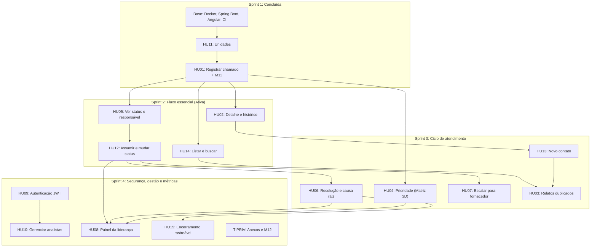

# Backlog Geral do MVP — Nexo

> **Data de atualização:** 27/10/2026  
> **Status geral:** Sprint 1 (Fundações + HU11 + HU01 + Instrumentação 9.5) concluída ✅ · Sprint 2 (Fluxo essencial: Fila, Detalhe, Status e Atribuição) ativa 🎯  
> **Referência oficial:** [Histórias de Usuário](./04-historias-de-usuario-Nexo.md), [Requisitos Funcionais](./02-requisitos-funcionais.md), [Análise de Domínio](./01-analise-de-dominio-Nexo.md) e Seção 9 do Documento do MVP (Métricas e Instrumentação).

> [!NOTE]
> Cada HU abaixo está no formato de **cartão do Trello**: história, regras de negócio, critérios de aceite, tarefas técnicas por camada e métricas relacionadas. As antigas "Levas" foram reorganizadas em **Sprints** (Leva 0 + Leva 1 = Sprint 1).

---

## 1. Visão Executiva

```
Total: 15 HUs + 2 trilhas transversais (Privacidade/LGPD e Qualidade 9.3)

Sprint 1 — Fundações & Entrada ........................ CONCLUÍDA ✅
Sprint 2 — Fluxo essencial (Fila, Detalhe, Status) .... ATIVA 🎯
Sprint 3 — Triagem, Resolução, Fornecedor, Duplicidade  PLANEJADA ⏳
Sprint 4 — Autenticação JWT, Gestão, Painel & Fecho ... PLANEJADA ⏳
```

| Sprint | HUs | Objetivo de negócio |
| :--- | :--- | :--- |
| **1** ✅ | HU11, HU01 (+ base técnica) | Registrar o primeiro chamado real no PostgreSQL com eventos imutáveis, datas UTC e telemetria M11. |
| **2** 🎯 | HU14, HU02, HU05, HU12 | O cliente ver o "coração" do sistema: chamado aberto → cai na fila → é assumido → muda de status, tudo com histórico. |
| **3** ⏳ | HU04, HU06, HU07, HU13, HU03 | Fechar o ciclo de atendimento: priorizar, resolver, escalar para fornecedor, registrar novos contatos e tratar duplicidade. |
| **4** ⏳ | HU09, HU10, HU08, HU15, T-PRIV, QA final | Autenticação definitiva, gestão de equipe, painel da liderança, encerramento rastreável e homologação. |

### Decisão de priorização (Tech Lead — 26/10/2026)

A autenticação JWT (HU09 — backend) foi movida para a **Sprint 4**. Motivo: para o cliente, o valor está em ver o fluxo essencial do chamado funcionando de ponta a ponta; login é um mecanismo que ele já conhece. Até lá, a API segue com o login básico temporário (usuários do seed `R__dados_dev.sql`).

> [!WARNING]
> **Impacto na coleta da Seção 9:** as métricas M01–M08 dependem do **autor real** de cada evento. O fluxo da Sprint 2 pode ser demonstrado e validado com o cliente, mas a **coleta oficial de dados** só deve começar depois da HU09 (Sprint 4), quando cada analista tiver sua própria sessão.

### Matriz de Papéis no Squad

| Membro | Papel | Foco no Backlog |
| :--- | :--- | :--- |
| **Luiz Henrique** | Tech Lead / Fullstack | Arquitetura, contratos OpenAPI, governança técnica e revisões |
| **Elis Tenório** | Backend & Banco de Dados | Migrations Flyway, regras de domínio e APIs Spring Boot |
| **Pedro Vinicius** | Frontend | Componentes Angular 22, formulários reativos, telas e Vitest |
| **Aguinaldo Anselmo** | Fullstack / Integração | Integração front/back e fluxos ponta a ponta |
| **Marcos Fraga** | QA, DevOps & Qualidade | CI/CD, automação de testes da Seção 9.3 e cenários de teste |
| **Sarah Cyrne** | Product & UX Lead | Escopo, regras de negócio, UX, LGPD e condução da coleta |

---

## 2. Mapa de Dependências por Sprint



> [!NOTE]
> A tabela original de dependências ([HU, seção 3](./04-historias-de-usuario-Nexo.md)) coloca HU12 dependendo de HU10. Na Sprint 2, a reatribuição usa os usuários já existentes na tabela `usuarios` (seed de dev); o CRUD de analistas (HU10) entra na Sprint 4 junto com o JWT.

---

## 3. Sprint 1 — Fundações & Entrada [CONCLUÍDA ✅]

### Base técnica

| ID | Entrega | Responsável | Entregáveis |
| :--- | :--- | :---: | :--- |
| **L0-01** | Docker Compose com PostgreSQL 16 (porta 5433) | Luiz | `docker-compose.yml`, `.env.example` |
| **L0-02** | Spring Boot 4.0.2, Java 21, Flyway, Bean Validation | Luiz | `backend/pom.xml`, `application.yml` |
| **L0-03** | Angular 22 com Tailwind CSS v4 e estrutura modular | Luiz | `frontend/package.json`, `styles.css` |
| **L0-04** | Pipeline de build e testes no GitHub Actions | Marcos / Luiz | `.github/workflows/ci.yml` |
| **L0-05** | Contrato OpenAPI inicial e envelope `ApiResponse` | Luiz | `docs/openapi-mvp.yaml`, `ApiResponse.java` |
| **L0-06** | Correção de 16 vulnerabilidades do frontend (`npm audit` = 0) | Luiz | PR #18 (`overrides` do Vite) |

### 🏷️ [HU11] Cadastrar e gerenciar unidades — ✅ Concluído

- **Responsáveis:** Elis (BE), Pedro / Luiz (FE) · **RF:** RF-024 · **Métrica:** base de M04 (por unidade)

**História:** Como liderança de TI, quero manter o cadastro das unidades da Rede Lúmen, para que todo chamado seja associado a uma unidade válida.

**Critérios de aceite**
- [x] Cadastrar unidade com nome e identificação única.
- [x] Editar e desativar unidades (desativação lógica, `ativo = false`).
- [x] Unidades desativadas não aparecem na abertura de novos chamados.
- [x] Chamados já registrados mantêm a associação com a unidade desativada.

**Tarefas técnicas**
- [x] **[BD]** `V2__cria_tabela_unidades.sql` com `identificacao` UNIQUE.
- [x] **[BE]** `UnidadeService` / `UnidadeController` (`GET`, `POST`, `PUT`, `PATCH /{id}/desativar`).
- [x] **[FE]** Tela de gestão em `features/admin/unidades/`.

### 🏷️ [HU01] Registrar um chamado + instrumentação 9.5 — ✅ Concluído

- **Responsáveis:** Elis (BE), Pedro (FE), Luiz (arquitetura) · **RF:** RF-001, RF-002, RF-008 · **Métricas:** M09 (canal), M11 (tempo de registro)

**História:** Como analista de suporte, quero registrar uma solicitação recebida por um canal existente como um chamado estruturado, para que o problema possa ser acompanhado e rastreado.

**Regras de negócio**
- Unidade, canal de origem, contato do solicitante, descrição (10 a 2000 caracteres) e categoria são obrigatórios.
- Canais aceitos: `LIGACAO`, `PRESENCIAL`, `WHATSAPP`, `EMAIL`.
- Contato com `@` é e-mail (gravado em minúsculas); sem `@` é telefone convertido para E.164. Contato conhecido reaproveita o solicitante (RN13).
- Aviso de LGPD no formulário: não registrar dados clínicos nem resultados de exames (RN01).
- `origem_dado` (`REAL` / `TESTE` / `SIMULADO`) é definido pelo servidor, nunca pelo cliente.

**Critérios de aceite**
- [x] Gera código único `LUM-AAAA-NNNNNN` (sequence no banco).
- [x] Grava em uma única transação: chamado, registro de contato inicial e eventos `CHAMADO_ABERTO` e `REGISTRO_DE_CONTATO_RECEBIDO`.
- [x] Envia `registro_iniciado_em` (abertura da tela) para a métrica M11.
- [x] Selo "MODO SIMULADO" visível quando `useMocks = true`.

**Tarefas técnicas**

| ID | Tarefa | Camada | Responsável | Status |
| :--- | :--- | :---: | :---: | :---: |
| **BE-01** | `V4__cria_chamados_e_registros_contato.sql` com campos da 9.5 (UTC, origem, prioridade sugerida/final, motivo de espera) | BD | Elis | ✅ |
| **BE-02** | `V5__cria_eventos_historico.sql`: tabela append-only com trigger que bloqueia UPDATE/DELETE | BD | Elis | ✅ |
| **BE-03** | `POST /api/v1/chamados` transacional com teste de rollback | BE | Elis | ✅ |
| **FE-01** | Telemetria M11 na tela Novo Chamado | FE | Pedro | ✅ |
| **FE-02** | Aviso LGPD e selo de modo simulado | FE | Pedro | ✅ |
| **FE-03** | Testes Vitest da tela Novo Chamado (23 testes) | FE | Pedro | ✅ |
| **INT-01** | Integração ponta a ponta (front real → backend dev) e validação da M11 via SQL | Integração | Aguinaldo / Luiz | 🎯 Em andamento |

---

## 4. Sprint 2 — Fluxo Essencial [ATIVA 🎯]

> **Meta da Sprint:** o cliente ver o chamado percorrer o fluxo principal no sistema real (sem mock): **abrir → aparecer na fila → abrir o detalhe → assumir → mudar status**, com cada passo registrado no histórico.

### 🏷️ [HU14] Listar e buscar chamados

- **Status:** ⏳ A iniciar (FE pronto com mock) · **Responsáveis:** Aguinaldo (BE), Pedro (FE)
- **RF:** RF-003 · **Métricas:** M02, apoio a M03

**História:** Como analista de suporte, quero listar e buscar chamados com filtros, para encontrar rapidamente os atendimentos que preciso tratar ou consultar.

**Regras de negócio**
- Listagem paginada (padrão: 20 por página), ordenada do mais recente para o mais antigo (`aberto_em DESC`).
- Filtros combináveis: status, unidade, prioridade e responsável.
- Filtros rápidos: "Meus chamados" e "Sem responsável" (`responsavel_id IS NULL`).
- Busca exata pelo código `LUM-AAAA-NNNNNN`.

**Critérios de aceite**
- [ ] A lista exibe código, unidade, status, prioridade e responsável.
- [ ] É possível filtrar por status, unidade, prioridade e responsável.
- [ ] É possível buscar pelo identificador único.
- [ ] É possível ver só os chamados atribuídos a mim.
- [ ] A partir da lista, é possível abrir o detalhe do chamado.

**Tarefas técnicas**
- [x] **[FE]** Tela da fila com filtros e badges (`features/chamados/fila-chamados`, 4 testes Vitest).
- [ ] **[BE]** `ChamadoSpecification` (Spring Data JPA) para filtros dinâmicos.
- [ ] **[BE]** `GET /api/v1/chamados` com `Pageable` e filtros opcionais (`unidade_id`, `status`, `prioridade`, `responsavel_id`, `codigo`).
- [ ] **[BE]** Atualizar `openapi-mvp.yaml` e `06-documentacao-api-mvp.md` com o contrato paginado.
- [ ] **[FE]** Ajustar `ChamadoService.listar()` ao formato paginado e desligar o mock da fila.
- [ ] **[QA]** Teste de integração dos filtros e verificação do RNF-004 (p95 < 1 s).

### 🏷️ [HU02] Consultar o histórico do chamado

- **Status:** ⏳ A iniciar (FE pronto com mock) · **Responsáveis:** Elis (BE), Pedro (FE)
- **RF:** RF-004 · **Métrica:** M01 (rastreabilidade)

**História:** Como analista de suporte, quero visualizar o histórico completo de um chamado, para entender o que já aconteceu e continuar o atendimento sem depender de mensagens espalhadas.

**Regras de negócio**
- A linha do tempo vem da tabela `eventos_historico`, em ordem cronológica (`ocorrido_em`).
- Cada evento mostra tipo, data/hora (UTC convertida para o horário local na tela) e autor.
- O histórico é somente leitura: o banco rejeita UPDATE e DELETE.

**Critérios de aceite**
- [ ] O histórico reúne os registros de contato associados ao chamado.
- [ ] Os acontecimentos relevantes do atendimento aparecem na linha do tempo.
- [ ] O responsável atual está visível.
- [ ] Um analista que não abriu o chamado consegue entender o histórico.

**Tarefas técnicas**
- [x] **[BD]** `eventos_historico` com trigger de imutabilidade (V5).
- [x] **[FE]** Tela de detalhe com linha do tempo (`features/chamados/detalhe-chamado`, 3 testes Vitest).
- [ ] **[BE]** `GET /api/v1/chamados/{id}` retornando dados do chamado, contatos e eventos ordenados.
- [ ] **[FE]** Conectar `ChamadoService.buscarPorId()` à API real.
- [ ] **[QA]** Teste de integração conferindo a ordem e o conteúdo da linha do tempo.

### 🏷️ [HU05] Acompanhar status e responsável

- **Status:** ⏳ A iniciar · **Responsáveis:** Elis (BE), Pedro (FE)
- **RF:** RF-015 · **Métrica:** M02

**História:** Como analista de suporte, quero visualizar o status e o responsável de cada chamado, para saber quais atendimentos estão em andamento e quem cuida de cada um.

**Regras de negócio**
- Status do domínio: `ABERTO`, `EM_TRIAGEM`, `EM_ATENDIMENTO`, `AGUARDANDO`, `RESOLVIDO`, `REABERTO`, `FECHADO`, `CANCELADO`, `MESCLADO`.
- Sem responsável, a tela mostra "Não atribuído".
- A HU05 trata da **visualização**; a ação de mudar status está na HU12.

**Critérios de aceite**
- [ ] Todo chamado exibe seu status atual.
- [ ] O analista responsável aparece quando houver.
- [ ] O ciclo de vida pode ser acompanhado pelo histórico.

**Tarefas técnicas**
- [x] **[BD]** Constraint `ck_chamados_status` e enum `StatusChamado`.
- [ ] **[BE]** Incluir `status` e `responsavel` (id e nome) nos DTOs da listagem e do detalhe.
- [ ] **[FE]** Exibir status e responsável com os dados reais da API.

### 🏷️ [HU12] Atribuir responsável e atualizar status

- **Status:** ⏳ A iniciar · **Responsáveis:** Elis / Aguinaldo (BE), Pedro (FE)
- **RF:** RF-015, RF-016 · **Métricas:** M02, M03 (TPR/TR)

**História:** Como analista de suporte, quero assumir, atribuir ou reatribuir um chamado e atualizar seu status, para que fique claro quem conduz cada atendimento e em que etapa ele está.

**Regras de negócio**
- Assumir: o chamado passa a ter o usuário atual como responsável.
- Reatribuir: só para analista ativo.
- Mudança de status só por transições válidas do ciclo de vida (ver [Análise de Domínio, §6](./01-analise-de-dominio-Nexo.md)). Ex.: `RESOLVIDO` só volta para `REABERTO`, nunca direto para `EM_TRIAGEM`.
- Ir para `AGUARDANDO` exige motivo: `FORNECEDOR`, `SOLICITANTE` ou `PECA_EQUIPAMENTO` (constraint `ck_chamados_espera`).
- Toda ação grava evento no histórico, na mesma transação, com data UTC e autor (`CHAMADO_ATRIBUIDO`, `CHAMADO_AGUARDANDO`, `RETORNO_RECEBIDO`, etc.).
- A primeira ação do analista sobre o chamado preenche `primeira_resposta_em` (base da M03).

**Critérios de aceite**
- [ ] É possível assumir um chamado para si.
- [ ] É possível reatribuir a outro analista ativo.
- [ ] Só transições válidas são aceitas.
- [ ] Toda atribuição e mudança de status aparece no histórico com data e autor.
- [ ] Transições inválidas são bloqueadas com mensagem explicativa.

**Tarefas técnicas**
- [ ] **[BE]** Máquina de estados no domínio (validação de transições em um único lugar).
- [ ] **[BE]** `PATCH /api/v1/chamados/{id}/responsavel` (assumir/reatribuir).
- [ ] **[BE]** `PATCH /api/v1/chamados/{id}/status` (com motivo de espera quando aplicável).
- [ ] **[BE]** Atualizar contrato OpenAPI e documentação da API.
- [ ] **[FE]** Botões "Assumir", "Reatribuir" e "Alterar status" na tela de detalhe.
- [ ] **[QA]** Testes de todas as transições permitidas e bloqueadas.

---

## 5. Sprint 3 — Ciclo de Atendimento [PLANEJADA ⏳]

### 🏷️ [HU04] Definir a prioridade (Matriz 3D)

- **Responsáveis:** Elis (BE), Pedro (FE) · **RF:** RF-009, RF-010 · **Métrica:** M08 (concordância)

**História:** Como analista de suporte, quero avaliar severidade, urgência e impacto operacional, para determinar a prioridade de forma estruturada.

**Regras de negócio**
- Severidade, urgência e impacto operacional avaliados separadamente (1 a 3).
- O sistema calcula a **prioridade sugerida** pela matriz da Análise de Domínio (§3): `ALTA`, `MEDIA` ou `BAIXA`.
- Se o analista escolher uma **prioridade final** diferente, a justificativa é obrigatória (constraint `ck_chamados_justificativa`).
- Solicitante ou gestor não define a prioridade final.

**Critérios de aceite**
- [ ] Severidade e urgência avaliadas separadamente; impacto faz parte da avaliação.
- [ ] A prioridade final resulta desses critérios.
- [ ] Divergência entre sugerida e final exige justificativa.
- [ ] A prioridade fica registrada no chamado e no histórico (`PRIORIDADE_DEFINIDA`).

**Tarefas técnicas**
- [ ] **[BE]** Serviço de cálculo da matriz com testes unitários de todas as combinações.
- [ ] **[BE]** Endpoint de triagem/prioridade.
- [ ] **[FE]** Componente de triagem com prévia da prioridade sugerida.

### 🏷️ [HU06] Registrar resolução e causa raiz

- **Responsáveis:** Elis (BE), Pedro (FE) · **RF:** RF-012, RF-014 · **Métricas:** M04 (TR), M06 (reabertura)

**História:** Como analista de suporte, quero registrar como o chamado foi resolvido e, quando identificada, sua causa raiz, para manter o conhecimento e reconhecer problemas recorrentes.

**Regras de negócio**
- Resolução obrigatória ao ir para `RESOLVIDO` (constraint `ck_chamados_resolucao`).
- Causa raiz opcional; `possivel_recorrencia` sinaliza problema recorrente.
- Grava `resolvido_em` (UTC) e evento `CHAMADO_RESOLVIDO`.

**Critérios de aceite**
- [ ] É possível registrar a resolução.
- [ ] É possível registrar a causa raiz, sem obrigatoriedade.
- [ ] O histórico permanece após a resolução.
- [ ] É possível distinguir atendimento pontual de causa recorrente.

**Tarefas técnicas**
- [ ] **[BE]** Endpoint de resolução.
- [ ] **[FE]** Formulário de resolução na tela de detalhe.

### 🏷️ [HU07] Escalar chamado para fornecedor externo

- **Responsável:** Aguinaldo · **RF:** RF-017, RF-018 · **Métrica:** M05 (tempo em terceiros)

**História:** Como analista de suporte, quero encaminhar um chamado a um fornecedor externo mantendo o acompanhamento interno, para que o atendimento não perca a rastreabilidade.

**Regras de negócio**
- O chamado vai para `AGUARDANDO` com motivo `FORNECEDOR`; o analista interno continua responsável.
- Registrar fornecedor, data de envio e data de retorno.
- Eventos `CHAMADO_ESCALADO` e `RETORNO_RECEBIDO`.

**Critérios de aceite**
- [ ] É possível indicar que o chamado depende de fornecedor e qual fornecedor recebeu.
- [ ] O histórico anterior continua disponível.
- [ ] O time interno continua identificável como responsável.
- [ ] É possível registrar o retorno e o fim do escalonamento.

**Tarefas técnicas**
- [ ] **[BD]** Nova migration para escalonamentos (fornecedor, envio, retorno).
- [ ] **[BE]** Endpoints de escalar e registrar retorno.
- [ ] **[FE]** Interface de escalonamento na tela de detalhe.

### 🏷️ [HU13] Registrar novo contato em chamado existente

- **Responsáveis:** Elis (BE), Pedro (FE) · **RF:** RF-006 · **Métricas:** M09, M01

**História:** Como analista de suporte, quero registrar um novo contato sobre um chamado aberto, para manter as interações concentradas no mesmo atendimento.

**Regras de negócio**
- Registra canal, direção (`RECEBIDO` / `ENVIADO`), data e quem relatou.
- Identificador externo único por canal (RN16, constraint `uq_registros_contato_externo`).
- Proibido incluir dados clínicos ou resultados de exames.

**Critérios de aceite**
- [ ] É possível adicionar um registro de contato a um chamado existente.
- [ ] O registro indica canal, data e quem relatou.
- [ ] O novo contato aparece no histórico.

**Tarefas técnicas**
- [ ] **[BE]** `POST /api/v1/chamados/{id}/contatos` com evento `REGISTRO_DE_CONTATO_RECEBIDO`.
- [ ] **[FE]** Formulário de novo contato na tela de detalhe.

> [!NOTE]
> O texto da HU13 em [04-historias-de-usuario-Nexo.md](./04-historias-de-usuario-Nexo.md) ainda cita o canal "outro". Ajustar para os 4 canais oficiais, como já feito na HU01.

### 🏷️ [HU03] Identificar relatos duplicados ou relacionados

- **Responsável:** Aguinaldo · **RF:** RF-011 · **Métrica:** M07

**História:** Como analista de suporte, quero associar relatos diferentes ao mesmo chamado quando se referem ao mesmo problema, para não tratar um incidente como vários atendimentos.

**Regras de negócio**
- Vincular relato a um chamado (`chamado_original_id` em `registros_contato`) sem apagar o registro original.
- Mesclar chamado duplicado no principal (RN17): status `MESCLADO` com `chamado_principal_id`, nunca apontando para si mesmo.
- Eventos `RELATO_VINCULADO`, `RELATO_DESVINCULADO` e `CHAMADO_MESCLADO`.

**Critérios de aceite**
- [ ] Mais de um registro de contato pode ser associado a um chamado.
- [ ] O analista identifica que relatos estão relacionados.
- [ ] Relatos associados continuam rastreáveis.
- [ ] A associação não apaga o contato original.

**Tarefas técnicas**
- [ ] **[BE]** Operações de vincular relato e mesclar chamado.
- [ ] **[FE]** Busca do chamado principal (usa a HU14) e confirmação da mesclagem.

---

## 6. Sprint 4 — Segurança, Gestão, Painel & Encerramento [PLANEJADA ⏳]

### 🏷️ [HU09] Autenticar no sistema (JWT)

- **Responsáveis:** Elis (BE), Pedro (FE) · **RF:** RF-021, RF-022 · **RNF:** RNF-005, RNF-007, RNF-010
- **Métrica:** pré-requisito da coleta oficial (autor real dos eventos M01–M08)

**História:** Como analista de suporte ou liderança de TI, quero acessar a plataforma com minhas credenciais, para usar apenas as funcionalidades permitidas ao meu perfil.

**Regras de negócio**
- Senha validada contra hash BCrypt da tabela `usuarios`.
- Perfis: `ANALISTA_SUPORTE`, `LIDERANCA_TI` (e `ADMIN`, ver decisões em aberto).
- Token JWT com expiração configurável (padrão de 1 hora, RNF-007).
- Mensagem genérica em credenciais inválidas; usuário inativo não entra.

**Critérios de aceite**
- [ ] Entrar com e-mail e senha.
- [ ] Usuário não autenticado não acessa telas de chamados.
- [ ] Credenciais inválidas mostram mensagem genérica.
- [ ] É possível sair (logout).
- [ ] Ações ficam associadas ao usuário autenticado.

**Tarefas técnicas**
- [x] **[BD]** `V3__cria_tabela_usuarios.sql` (BCrypt + perfil) e seed de dev.
- [x] **[FE]** Tela de login (`features/auth/login`, 5 testes Vitest).
- [x] **[FE]** `TokenStorageService` e `authInterceptor` (anexa o Bearer token quando existir).
- [ ] **[BE]** `POST /api/v1/auth/login` gerando JWT com claims de perfil.
- [ ] **[BE]** Filtro JWT no Spring Security substituindo o HTTP Basic temporário.
- [ ] **[FE]** Guarda de rotas (`core/guards` ainda vazio) e logout.
- [ ] **[QA]** Testes de login válido, senha errada, usuário inativo e token expirado.

### 🏷️ [HU10] Gerenciar analistas

- **Responsável:** Aguinaldo · **RF:** RF-023

**História:** Como liderança de TI, quero cadastrar, editar e desativar analistas, para controlar quem pode atuar nos chamados.

**Critérios de aceite**
- [ ] Cadastrar analista com nome, e-mail e perfil (e-mail único).
- [ ] Editar dados de um analista.
- [ ] Desativar sem apagar o histórico de atuação.
- [ ] Analista desativado não acessa o sistema nem recebe novos chamados.

**Tarefas técnicas**
- [ ] **[BE]** CRUD de usuários restrito ao perfil autorizado.
- [ ] **[FE]** Tela em `features/admin/analistas/`.

### 🏷️ [HU08] Visualizar a situação dos chamados (Painel da Liderança)

- **Responsáveis:** Elis / Luiz (BE), Pedro (FE) · **RF:** RF-026, RF-027, RF-028 · **Métricas:** M01–M12

**História:** Como liderança de TI, quero visualizar chamados em aberto, responsáveis e informações agregadas, para acompanhar o suporte e identificar padrões.

**Regras de negócio**
- Uma consulta por métrica (M01–M12), filtrável por período e unidade.
- Destacar os limiares da Seção 9.7. Ex.: M12 > 0 bloqueia a coleta; M08 > 30% leva a recalibrar a matriz; M11 > 60 s leva a reduzir campos obrigatórios.
- Dados simulados ou de teste não entram nas métricas oficiais (filtro por `origem_dado`).

**Critérios de aceite**
- [ ] Ver chamados em aberto e seus responsáveis.
- [ ] Consultar informações agregadas por unidade.
- [ ] Identificar problemas recorrentes.
- [ ] As informações vêm só dos chamados registrados na plataforma.

**Tarefas técnicas**
- [ ] **[BE]** Consultas agregadas das métricas M01–M12.
- [ ] **[FE]** Dashboard em `features/dashboard/` (pasta ainda vazia).

### 🏷️ [HU15] Encerrar chamado com verificação de rastreabilidade

- **Responsáveis:** Elis (BE), Pedro (FE) · **RF:** RF-013, RF-028 · **Métrica:** M01 (métrica principal)

**História:** Como analista de suporte, quero encerrar um chamado resolvido e saber se o registro está completo, para garantir que fique rastreável.

**Critérios de aceite**
- [ ] Só encerra chamado em `RESOLVIDO`.
- [ ] Verifica: problema, unidade, responsável, ao menos um contato, evolução de status e resolução.
- [ ] Indica o que está pendente quando falta algo.
- [ ] Registra o encerramento no histórico (`CHAMADO_FECHADO`) e grava `fechado_em`.
- [ ] Armazena o resultado da verificação para a métrica M01.

**Tarefas técnicas**
- [ ] **[BE]** Verificador de rastreabilidade e endpoint de encerramento.
- [ ] **[FE]** Checklist visual de pendências antes de encerrar.

### 🏷️ [T-PRIV] Anexos com privacidade e auditoria (LGPD)

- **Responsáveis:** Elis (BE), Pedro (FE), Marcos (QA) · **RF:** RF-007, RF-008 · **RNF:** RNF-009 · **Métrica:** M12 (meta zero)

**Objetivo:** Anexos ocultos por padrão, restritos a analistas e com log de cada visualização.

**Critérios de aceite**
- [ ] Anexos não são exibidos automaticamente.
- [ ] Liderança de TI não abre anexos (RN06).
- [ ] Cada visualização grava evento `ANEXO_VISUALIZADO` com autor e data.

**Tarefas técnicas**
- [ ] **[BD]** Migration de anexos.
- [ ] **[BE]** Download com verificação de perfil e gravação do evento.
- [ ] **[FE]** Componente de anexo com bloqueio visual.

> [!NOTE]
> Não existe HU formal de anexos no documento de histórias. A Sarah deve decidir se esta trilha vira uma HU (HU16) ou continua como tarefa transversal.

---

## 7. Trilha de Qualidade & Testes (Seção 9.3) — Marcos Fraga

| ID | Tipo de teste | O que valida | Métricas | Sprint |
| :--- | :--- | :--- | :--- | :---: |
| **QA-01** | Cálculo (unitário) | TT, TPR, TR, percentil 90 e % dentro da meta, com pausa e reabertura | M03, M04 | 3 |
| **QA-02** | Eventos (integração) | Todo comando de domínio grava evento imutável; idempotência | M01–M08, RN16, RN19 | 2 → 4 |
| **QA-03** | Privacidade e RBAC | Liderança não vê anexos; solicitante não vê SLAs internos | M12, RN06, RN12 | 4 |
| **QA-04** | Massa de demonstração | Script da "manhã de segunda-feira" com `origem_dado = SIMULADO` | 9.1, 9.3 | 4 |
| **QA-05** | Usabilidade e coleta manual | Protocolo de medição de M11 e contagem semanal de M10 | M10, M11 | 4 |

**Estado atual dos testes:** 44 testes Vitest no frontend (7 arquivos) e, no backend, testes de `ChamadoService`, `EventoHistoricoService`, `SolicitanteService`, `ChamadoController` e integração com rollback do registro de chamado.

---

## 8. Decisões em Aberto

| Decisão | Impacta | Responsável |
| :--- | :--- | :--- |
| Liderança de TI ou um perfil `ADMIN` cadastra analistas e unidades? | HU10, HU11, HU09 | Sarah + Luiz |
| Fornecedor externo é campo livre ou cadastro próprio (nova HU)? | HU07 | Sarah |
| Quem tem autoridade para reclassificar a prioridade? | HU04 | Sarah + mentor |
| Anexos viram HU formal (HU16)? | T-PRIV | Sarah |
| Nova data da janela de coleta, considerando o JWT na Sprint 4 | Seção 9.4 | Sarah + Luiz |

---

## 9. Definição de Pronto (Definition of Done)

Toda tarefa só é considerada concluída quando:

1. **Branch e commits padronizados:** `feat/HUXX-descricao` e Conventional Commits (`feat:`, `fix:`, `docs:`, `test:`).
2. **Pull Request completo:** aberto para `develop` com o [template padrão](../.github/pull_request_template.md) preenchido.
3. **Testes na mesma PR:** código novo acompanhado de testes unitários ou de integração.
4. **Sem dados sensíveis:** nada de nomes, CPFs, e-mails reais, prontuários ou exames em fixtures, seeds ou prints.
5. **Revisão cruzada:** ao menos uma aprovação de outra especialidade (frontend revisa backend e vice-versa).
6. **CI verde:** build e testes do GitHub Actions passando.
7. **Documentação atualizada:** se a PR muda contrato ou conclui uma HU, atualiza este backlog e a documentação da API na mesma PR.
