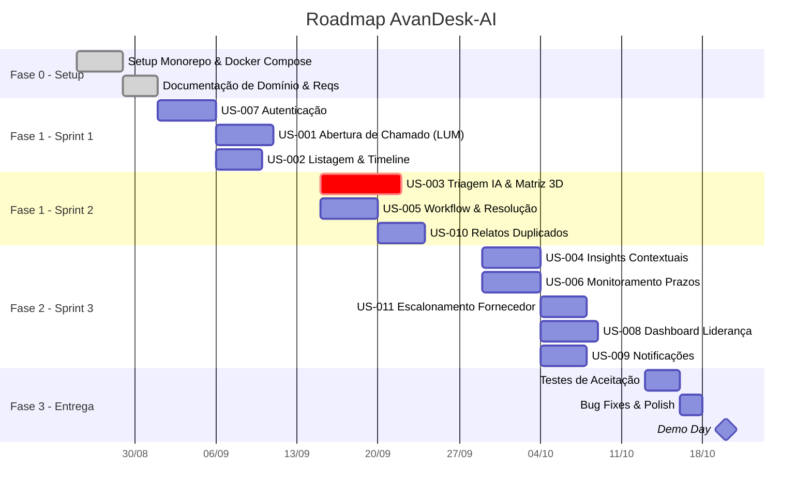

# 🚀 Próximos Passos — AvanDesk-AI

## Status Atual

| Item | Status |
|------|:------:|
| Repositório GitHub | ✅ Criado |
| Documentação de Domínio (Rede Lúmen) | ✅ Concluída |
| Requisitos Funcionais | ✅ Refinados |
| Requisitos Não Funcionais | ✅ Refinados |
| User Stories & Tasks | ✅ Refinadas |
| Definição de Stack Backend | ✅ Java 21 + Spring Boot 4.0.2 |
| Definição de Stack Frontend | ✅ Angular 22 + Tailwind CSS v4 |
| Definição de Serviço de IA | ✅ Azure OpenAI Service (GPT-4o) |
| Início do Desenvolvimento | ⏳ Em Andamento (Sprint 1) |

---

## 🔴 Pontos de Decisão & Pendências com o Cliente

### 1. Stack Backend & Banco de Dados (Definido)
* **Decisão:** **Java 21 + Spring Boot 4.0.2** com **PostgreSQL 16** via Docker Compose e migrations via Flyway.
* **Justificativa:** Alinhamento direto com o ecossistema Avanade, alta maturidade em POO/Java e produtividade com Spring Data JPA.

### 2. Serviço de IA para Triagem (Definido)
* **Decisão:** **Azure OpenAI Service (GPT-4o)** encapsulado sob Adapter Pattern.
* **Justificativa:** Melhor fit para análise semântica de chamados, avaliação da Matriz 3D (Severidade, Urgência e Impacto) e geração de insights em português.

### 3. Pendências de Validação com a Rede Lúmen
Estas questões impactam os refinamentos das próximas sprints e estão em validação com a equipe do cliente:

| Pendência | Impacto no Projeto | Ação Prevista |
|---|---|---|
| **Sistema de Telefonia** | Determina se haverá integração futura com gravação de ramais. | Acompanhar com mentor e manter abertura manual no MVP. |
| **SLA Informal** | Existência de metas tácitas praticadas internamente por tipo de falha. | Parametrizar tempos como referência interna de acompanhamento. |
| **Alçada de Prioridade** | Deliberação em eventuais conflitos de prioridade com gestores locais. | Analista de suporte mantém arbitragem oficial no sistema. |
| **Campos Seguros (LGPD)** | Validação dos campos técnicos sem risco de conter dados de pacientes. | Proibir campos livres para laudos ou prontuários médicos. |

---

## 📈 Métrica Principal de Sucesso do MVP

* **Métrica:** **% de chamados com histórico completo e rastreável**
* **Fórmula:** 
$$\% = \frac{\text{Chamados encerrados com histórico completo}}{\text{Total de chamados encerrados}} \times 100$$
* **Objetivo:** Garantir que 100% dos chamados concluídos possuam registro estruturado do problema, identificador `LUM-AAAA-NNNNNN`, unidade associada, responsável atribuído, timeline de contatos e solução registrada.

---

## 📅 Roadmap por Fases

### Fase 0 — Setup & Arquitetura (Semana 1)

- [x] Definição de stack (Java 21, Spring Boot 4, Angular 22, PostgreSQL 16)
- [x] Setup do monorepo com Docker Compose
- [x] Configuração inicial de backend, frontend e migrations Flyway
- [x] Documentação de requisitos alinhada à Rede Lúmen
- [x] Configuração de CI/CD via GitHub Actions e regras de Conventional Commits

### Fase 1 — Fundação & Registro (Sprints 1–2 · Semanas 2–5)

- [ ] **Sprint 1:** US-007 (Auth), US-001 (Abertura de Chamado LUM), US-002 (Listagem e Timeline)
- [ ] **Sprint 2:** US-003 (Triagem IA & Matriz 3D), US-005 (Workflow de Status), US-010 (Mesclagem e Duplicados)
- [ ] Testes integrados e validação de regras de segurança LGPD

### Fase 2 — Inteligência & Operação (Sprint 3 · Semanas 6–7)

- [ ] US-004 (Insights Contextuais)
- [ ] US-006 (Monitoramento de Prazos)
- [ ] US-011 (Escalonamento para Fornecedor Externo)
- [ ] US-008 (Dashboard de Métricas da Liderança)
- [ ] US-009 (Notificações)

### Fase 3 — Refinamento & Entrega (Semana 8)

- [ ] Testes de aceitação com stakeholders da Residência Avanade
- [ ] Correção de bugs e polish de UX
- [ ] Documentação de usuário final e medição de KPIs
- [ ] Apresentação final / Demo Day

---

## 📊 Cronograma Visual

---

## 🔮 Evoluções Futuras (Pós-MVP)

1. **Automação de Triagem Avançada:** Análise em tempo real de lacunas contextuais durante a digitação.
2. **Atendimento Automatizado por Voz:** Captura estruturada de solicitações telefônicas sem gravação de áudio bruto.
3. **Sugestão Automática de Duplicidades:** Comparação semântica instantânea sugerindo mesclagem de novos chamados.
4. **Inteligência de Recorrência (Problemas):** Agrupamento automático de incidentes com mesma causa raiz.
5. **Indicadores Preditivos:** Alertas de tendências operacionais por unidade da Rede Lúmen.

---

## 🎯 Definição de Pronto (Definition of Done)

Uma User Story é considerada **pronta** quando:

- [ ] Código implementado e revisado (Code Review aprovado via PR)
- [ ] Testes unitários escritos e passando (≥ 70% cobertura)
- [ ] Testes E2E passando para o fluxo principal
- [ ] Sem erros de lint e formatação
- [ ] Build de CI passando sem falhas no GitHub Actions
- [ ] Sem dados clínicos ou de pacientes trafegando em payloads
- [ ] Critérios de aceite verificados e demonstrados
- [ ] Documentação técnica atualizada

---

## 📎 Referências

- [Análise de Domínio](./01-analise-de-dominio.md)
- [Requisitos Funcionais](./02-requisitos-funcionais.md)
- [Requisitos Não Funcionais](./03-requisitos-nao-funcionais.md)
- [User Stories & Tasks](./04-historias-de-usuario.md)
