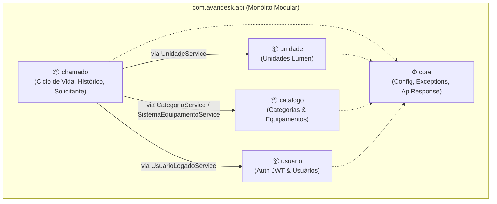

# ADR-001: Modularização do Backend em Pacotes por Funcionalidade (*Package-by-Feature / Vertical Slices*)

* **Status:** 🟢 Aceito
* **Data:** 2026-10-28
* **Decisores:** Luiz Henrique Souza (Tech Lead / Fullstack) e Equipe Nexo (Squad 01)
* **Escopo:** Backend (`com.avandesk.api`)
* **Referência Técnica:** Commit `c86dee5` (`refactor(arch): reorganizar backend em pacotes modulares por funcionalidade`) · PR #21

---

## 1. Contexto e Declaração do Problema

No início do desenvolvimento do MVP do **Nexo** (plataforma de suporte técnico e triagem da Rede Lúmen Diagnósticos), o backend Spring Boot foi estruturado seguindo o padrão clássico **Package-by-Layer** (pacotes divididos horizontalmente por camada técnica):

```text
com.avandesk.api/
├── config/
├── controller/      ← Todos os controllers misturados
├── dto/             ← Todos os Requests e Responses do sistema juntos
├── entity/          ← Todas as entidades JPA e Enums na mesma pasta
├── exception/
├── repository/      ← Todos os repositórios JPA juntos
└── service/         ← Todas as regras de negócio de domínios distintos juntas
```

Com o avanço das entregas das Histórias de Usuário — englobando abertura e ciclo de vida de chamados (`HU01`), gestão de unidades hospitalares (`HU11`), catálogo de categorias e equipamentos de diagnóstico (`HU01`/`HU12`) e autenticação JWT stateless (`HU09`) — identificamos um **gargalo estrutural severo**:

1. **"Sopa de Letras" e Baixa Coesão Funcional:** A visualização de pacotes como `entity/`, `dto/`, `service/` e `repository/` tornou-se uma lista extensa e heterogênea onde classes de domínios completamente distintos (`Chamado`, `EventoHistorico`, `RegistroContato`, `Solicitante`, `Unidade`, `Categoria`, `SistemaEquipamento`, `Usuario`, `PerfilUsuario`) coexistiam no mesmo diretório sem separação semântica.
2. **Acoplamento Indevido e Fronteiras Invisíveis:** Como todos os `Service` e `Repository` residiam nos mesmos pacotes horizontais, não havia clareza visual nem estrutural sobre quais classes pertenciam a qual contexto de negócio (*Bounded Context*). Isso facilitava o acesso cruzado direto a repositórios de outros domínios em vez de passar pelas regras de validação do serviço responsável.
3. **Alto Custo Cognitivo e Conflitos no Git Flow:** Para alterar uma única regra de negócio (ex.: validação de unidade ativa ou autenticação de usuário), o desenvolvedor precisava saltar entre 5 pastas distantes na árvore do projeto, aumentando a probabilidade de conflitos de merge entre branches paralelas da equipe.
4. **Fricção em Testes e Performance de Manutenção:** A estrutura em camadas horizontais dificultava a execução isolada de testes por módulo de negócio e a visualização rápida de gargalos transacionais e de consultas JPA dentro de cada fluxo operacional.

---

## 2. Drivers de Decisão (Fatores Motivadores)

* **Alta Coesão (*Common Closure Principle — CCP*):** Classes que mudam juntas pelo mesmo motivo de negócio devem morar juntas no mesmo pacote/módulo.
* **Baixo Acoplamento Inter-modular:** Cada subdomínio deve proteger suas invariantes de negócio (ex.: verificar se `Unidade`, `Categoria` ou `SistemaEquipamento` estão ativos antes de vincular a um `Chamado`) expondo operações claras via camada de serviço.
* **Performance e Eficiência Operacional:**
  * Uso disciplinado de transações enxutas e somente leitura (`@Transactional(readOnly = true)`) nas consultas de catálogos, unidades e validações cruzadas (otimizando o *dirty checking* do Hibernate e o uso do pool de conexões JDBC).
  * Execução rápida e seletiva de suítes de testes por módulo (`./mvnw test -Dtest="com.avandesk.api.chamado.**.*Test"`).
* **Escalabilidade Evolutiva (Monólito Modular):** Preparar a base de código para crescer com as próximas etapas (Matriz 3D de Priorização, Triagem assistida por IA, Controle de SLA e Dashboard Operacional) mantendo limites claros compatíveis com **Clean Architecture** e **DDD (Bounded Contexts)**.

---

## 3. Opções Consideradas

### Opção 1: Manter *Package-by-Layer* (Pacotes Horizontais por Camada)
* **Prós:** Familiar para iniciantes em projetos CRUD pequenos; zero esforço imediato de refatoração.
* **Contras:** Agrava exponencialmente a "sopa de letras" conforme novas features entram; viola o princípio de alta coesão; esconde os conceitos de domínio da Rede Lúmen atrás de jargões puramente técnicos (`controller`, `service`, `dto`).

### Opção 2: *Package-by-Feature / Vertical Slices* (Monólito Modular por Domínio) — **Escolhida**
* **Prós:** Agrupa cada contexto de negócio (`chamado`, `unidade`, `catalogo`, `usuario`) e a infraestrutura transversal (`core`) em pacotes independentes e coesos; reduz drasticamente a carga cognitiva; explicita as dependências entre módulos; mantém a simplicidade de deploy de um único artefato Spring Boot.
* **Contras:** Exige disciplina da equipe para respeitar as fronteiras entre pacotes e não criar dependências cíclicas entre módulos.

### Opção 3: Extração para Microsserviços Distribuídos
* **Prós:** Isolamento físico total de deploy e banco de dados por serviço.
* **Contras:** Complexidade operacional desproporcional (rede, transações distribuídas, múltiplos deploys, custo de nuvem) para o horizonte de 3 meses do MVP e equipe de 6 integrantes (*over-engineering*).

---

## 4. Decisão Arquitetural

Decidimos **migrar a estrutura do backend de *Package-by-Layer* para *Package-by-Feature* (*Vertical Slices* / Monólito Modular)**, organizando o pacote raiz `com.avandesk.api` em **5 módulos bem definidos**:

```text
com.avandesk.api/
├── AvanDeskApiApplication.java
├── core/                  # Infraestrutura transversal compartilhada
│   ├── config/            # SecurityConfig, NexoProperties
│   ├── dto/               # ApiResponse<T> (envelope padrão REST)
│   ├── exception/         # GlobalExceptionHandler, RecursoNaoEncontradoException, RegraNegocioException
│   └── health/            # HealthController
├── usuario/               # Identidade, autenticação stateless JWT e perfis de acesso
│   ├── controller/        # AuthController
│   ├── dto/               # LoginRequest, LoginResponse, UsuarioAutenticadoResponse
│   ├── entity/            # Usuario, PerfilUsuario
│   ├── repository/        # UsuarioRepository
│   ├── security/          # JwtAuthenticationFilter
│   └── service/           # AuthService, JwtService, UsuarioDetailsService, UsuarioLogadoService
├── chamado/               # Core Domain: ciclo de vida do chamado, histórico auditável e contatos
│   ├── controller/        # ChamadoController
│   ├── dto/               # ChamadoRequest, ChamadoResponse, SolicitanteRequest
│   ├── entity/            # Chamado, EventoHistorico, RegistroContato, Solicitante e Enums do ciclo
│   ├── repository/        # ChamadoRepository, EventoHistoricoRepository, RegistroContatoRepository, SolicitanteRepository
│   └── service/           # ChamadoService, EventoHistoricoService, SolicitanteService
├── unidade/               # Gestão de unidades hospitalares e laboratoriais da Rede Lúmen
│   ├── controller/        # UnidadeController
│   ├── dto/               # UnidadeRequest, UnidadeResponse
│   ├── entity/            # Unidade
│   ├── repository/        # UnidadeRepository
│   └── service/           # UnidadeService
└── catalogo/              # Catálogo operacional de categorias e sistemas/equipamentos médicos
    ├── controller/        # CategoriaController, SistemaEquipamentoController
    ├── dto/               # CategoriaResponse, SistemaEquipamentoResponse
    ├── entity/            # Categoria, SistemaEquipamento
    ├── repository/        # CategoriaRepository, SistemaEquipamentoRepository
    └── service/           # CategoriaService, SistemaEquipamentoService
```

### Regras de Governança entre Módulos

1. **Encapsulamento de Persistência:** Nenhum módulo pode injetar diretamente o `Repository` de outro módulo.
   * *Exemplo prático aplicado:* O `ChamadoService` (módulo `chamado`) **não** acessa `UnidadeRepository`, `CategoriaRepository` ou `SistemaEquipamentoRepository`. Em vez disso, ele consome os métodos de negócio `unidadeService.obterAtivaParaNovoChamado(...)`, `categoriaService.obterAtivaParaNovoChamado(...)` e `sistemaEquipamentoService.obterAtivoParaNovoChamado(...)`.
2. **Direção das Dependências:**
   * Todos os módulos podem depender de `core` (exceções de negócio, configurações e envelope `ApiResponse`).
   * O módulo `core` **não deve depender de regras de negócio** de `chamado`, `unidade` ou `catalogo`.
   * Proibida a criação de dependências cíclicas entre `Services` de módulos distintos.
3. **Espelhamento na Árvore de Testes (`src/test/java`):**
   * Os testes unitários e de integração seguem exatamente a mesma árvore modular (`com.avandesk.api.chamado.*`, `com.avandesk.api.usuario.*`, etc.), facilitando o isolamento por contexto.



---

## 5. Consequências e Impactos Observados

### Ganhos Positivos
* **Alta Coesão e Fim da "Sopa de Letras":** A estrutura de diretórios agora "grita a arquitetura do negócio" (*Screaming Architecture*, Robert C. Martin). Ao abrir `com.avandesk.api`, enxergam-se imediatamente os domínios da Rede Lúmen (`chamado`, `unidade`, `catalogo`, `usuario`), e não apenas pastas genéricas.
* **Desacoplamento Real de Regras de Validação:** A validação de se uma unidade ou equipamento está ativo ficou centralizada em seu respectivo módulo (`UnidadeService`, `CategoriaService`, `SistemaEquipamentoService`), evitando duplicação de código no `ChamadoService`.
* **Ganho de Performance (Runtime e Build/Test):**
  * Consultas de validação e listagem nos serviços modulares operam com `@Transactional(readOnly = true)`, desativando snapshots desnecessários do Hibernate em leituras.
  * Suítes de teste com Mockito (`@ExtendWith(MockitoExtension.class)`) rodam em milissegundos por módulo, pois o `ChamadoServiceTest` mocka apenas as fronteiras de serviço dos outros módulos sem precisar instanciar repositórios alheios.
* **Paralelismo na Squad:** Desenvolvedores trabalhando em `unidade`, `usuario` ou `chamado` atuam em diretórios isolados, reduzindo drasticamente conflitos de merge na branch `develop`.

### Trade-offs e Cuidados Necessários
* **Disciplina de Imports:** O Java permite que classes `public` sejam importadas de qualquer pacote. Portanto, durante o *Code Review* dos Pull Requests (conforme `.github/convencoes-git-workflow-lumen.md`), o Tech Lead e os revisores devem verificar que nenhum módulo importou um `*Repository` de outro módulo.
* **Evolução Futura para Clean Architecture Estrita:** Caso a complexidade de regras de domínio dentro de um módulo cresça significativamente (ex.: motor de priorização 3D e SLA dentro de `chamado`), o próprio pacote `chamado` poderá evoluir internamente para subcamadas de Clean Architecture (`domain`, `application`, `infrastructure`, `presentation`) sem impactar os demais módulos vizinhos.

