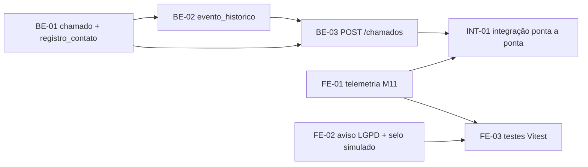

# Backlog: Tarefas de Instrumentação do Chamado (HU01 + Seção 9.5)

> **Origem:** itens P0 de [avaliacao-tecnica-time.md](./avaliacao-tecnica-time.md) e Seção 9.5 do doc SLA (rascunho de 07/10/2026).  
> **Objetivo da entrega:** sair do mock e ter o **primeiro chamado real gravado com eventos, datas em UTC, origem do dado e telemetria de registro**. Sem isso, nenhuma métrica M01–M12 pode ser coletada.  
> **Fora do escopo desta leva:** prioridade (HU04), atribuição/status (HU05/HU12), escalonamento, mesclagem e anexos. Essas tarefas entram depois que as Seções 2–5 do doc SLA (regras do relógio e matriz) forem incorporadas.

---

## Visão geral

| ID | Perfil | Responsável | Tarefa | Relação com o backlog atual | Depende de | Estimativa sugerida |
| :-- | :-- | :-- | :--- | :--- | :--- | :--- |
| **BE-01** | BD/Backend | Elis | Modelar `chamado` e `registro_contato` com os campos da 9.5 | Amplia T01.1 e T01.2 | — | 1 dia |
| **BE-02** | BD/Backend | Elis | Criar `evento_historico` imutável + serviço de registro de eventos | Amplia T02.1 e T01.4 | BE-01 | 1 dia |
| **BE-03** | BD/Backend | Elis | Implementar `POST /api/v1/chamados` gravando chamado, contato e eventos numa transação | Amplia T01.3 e T01.4 | BE-01, BE-02 | 1,5 dia |
| **FE-01** | Frontend | Pedro | Telemetria de registro (M11) na tela Novo Chamado | Nova (9.5) | — | 0,5 dia |
| **FE-02** | Frontend | Pedro | Aviso de dados clínicos (LGPD) + selo de "modo simulado" | T01.6 + nova (9.1/9.6) | — | 0,5 dia |
| **FE-03** | Frontend | Pedro | Testes unitários (Vitest) da tela Novo Chamado | Critério de T01.5 | FE-01, FE-02 | 1 dia |
| **INT-01** | Integração | Aguinaldo | Ligar a tela Novo Chamado ao backend real e validar ponta a ponta | Fecha a HU01 | BE-03, FE-01 | 1 dia |

> [!TIP]
> As trilhas de BE e FE andam **em paralelo** desde o primeiro dia. O FE trabalha contra o mock (`useMocks: true`), que deve ser atualizado com os campos novos na FE-01. A INT-01 é o ponto de encontro.

---

## Trilha BD/Backend

### BE-01: Modelar `chamado` e `registro_contato` com os campos da Seção 9.5

**Contexto:** a `V1__init_schema.sql` está vazia e só existe a tabela `unidades` (V2). A Seção 9.5 avisa que dados não gravados desde o primeiro chamado não podem ser reconstruídos. Por isso as colunas de instrumentação entram **agora**, mesmo que algumas só sejam preenchidas por HUs futuras.

**O que fazer**
1. Criar `backend/src/main/resources/db/migration/V3__cria_chamado_e_registro_contato.sql` com:
   - **`chamado`**:
     - `id UUID PK`;
     - `codigo VARCHAR(20) UNIQUE NOT NULL`, no formato `LUM-AAAA-NNNNNN`, gerado a partir de uma `SEQUENCE`;
     - `unidade_id UUID NOT NULL FK → unidades`;
     - `canal_origem VARCHAR(20) NOT NULL CHECK (...)`;
     - `solicitante_nome VARCHAR(120) NULL` e `solicitante_contato VARCHAR(255) NOT NULL`;
     - `descricao VARCHAR(2000) NOT NULL`;
     - `status VARCHAR(30) NOT NULL DEFAULT 'ABERTO'`;
     - `autor_id VARCHAR(120) NOT NULL`, provisório até a HU09 (depois vira FK para `usuario`);
     - `origem_dado VARCHAR(10) NOT NULL CHECK (origem_dado IN ('REAL','TESTE','SIMULADO'))`.
   - **Colunas de instrumentação da 9.5** (todas `NULL` por enquanto), com `TIMESTAMPTZ` em todas as datas:
     - datas: `aberto_em NOT NULL`, `primeira_resposta_em`, `resolvido_em`, `registro_iniciado_em`;
     - espera: `motivo_espera`, `espera_iniciada_em`;
     - prioridade: `prioridade_sugerida`, `prioridade_final`, `justificativa_prioridade`;
     - mesclagem: `chamado_principal_id UUID FK → chamado`.
   - **`registro_contato`**:
     - `id UUID PK`;
     - `chamado_id UUID NOT NULL FK → chamado`;
     - `canal VARCHAR(20) NOT NULL`;
     - `direcao VARCHAR(10) NOT NULL CHECK (direcao IN ('RECEBIDO','ENVIADO'))`;
     - `identificador_externo VARCHAR(255) NULL UNIQUE`, para a RN16;
     - `conteudo VARCHAR(2000)`;
     - `recebido_em TIMESTAMPTZ NOT NULL`;
     - `origem_dado`.
   - Índices em `chamado(unidade_id)`, `chamado(status)` e `registro_contato(chamado_id)`.
2. Configurar UTC no `application.yml`: `spring.jpa.properties.hibernate.jdbc.time_zone: UTC`.
3. Criar as entidades `Chamado` e `RegistroContato` (usando `Instant` para datas), os enums `CanalOrigem`, `StatusChamado`, `DirecaoContato` e `OrigemDado`, e os repositórios. Seguir o padrão de [Unidade.java](../backend/src/main/java/com/avandesk/api/entity/Unidade.java).
4. Criar a propriedade `nexo.origem-dado` por perfil: `dev`/teste = `TESTE`, `prod` = `REAL`. **O cliente nunca envia esse valor.**

**Critérios de aceite**
- [ ] `./mvnw spring-boot:run` aplica a V3 sem erro num banco limpo (`docker compose down -v && docker compose up -d`).
- [ ] Inserir chamado com `unidade_id` inexistente falha por FK. Inserir dois chamados com o mesmo `codigo` falha por UNIQUE.
- [ ] Inserir dois `registro_contato` com o mesmo `identificador_externo` falha. Com `NULL`, os dois são aceitos.
- [ ] Toda coluna de data é `timestamptz` (conferir com `\d chamado` no psql).
- [ ] A enum `CanalOrigem` é a mesma do contrato (`LIGACAO, PRESENCIAL, WHATSAPP, EMAIL`). Se o produto aprovar `OUTRO`, incluir também no `CHECK`.

**Fora do escopo:** regras de transição de status, cálculo de prioridade e tabelas de escalonamento e anexos.

---

### BE-02: Criar `evento_historico` imutável + serviço de registro de eventos

**Contexto:** a 9.5 exige *tipo, data/hora e autor de todos os eventos de domínio*. Esses eventos alimentam M01–M08. A T02.1 já pede que eventos "não possam ser alterados nem excluídos".

**O que fazer**
1. Criar `V4__cria_evento_historico.sql` com:
   - colunas: `id UUID PK`, `chamado_id UUID NOT NULL FK → chamado`, `tipo VARCHAR(40) NOT NULL`, `ocorrido_em TIMESTAMPTZ NOT NULL DEFAULT now()`, `autor_id VARCHAR(120) NOT NULL`, `dados JSONB NOT NULL DEFAULT '{}'` (valores anterior/novo, motivo etc.) e `origem_dado VARCHAR(10) NOT NULL`;
   - `CHECK` de `tipo` com os **18 eventos** da Análise de Domínio §6: `CHAMADO_ABERTO, REGISTRO_DE_CONTATO_RECEBIDO, TRIAGEM_INICIADA, PRIORIDADE_DEFINIDA, CHAMADO_TRIADO, CHAMADO_ATRIBUIDO, CHAMADO_AGUARDANDO, RETORNO_RECEBIDO, CHAMADO_ESCALADO, CHAMADO_RESOLVIDO, CHAMADO_REABERTO, CHAMADO_FECHADO, CHAMADO_CANCELADO, RELATO_VINCULADO, RELATO_DESVINCULADO, CHAMADO_MESCLADO, NOTIFICACAO_ENVIADA, ANEXO_VISUALIZADO`;
   - **trigger** `BEFORE UPDATE OR DELETE` que lança exceção, para garantir que a tabela é append-only no próprio banco;
   - índice em `(chamado_id, ocorrido_em)`.
2. Criar a entidade `EventoHistorico` (sem setters públicos depois da criação), o enum `TipoEvento` e o `EventoHistoricoRepository`.
3. Criar `EventoHistoricoService.registrar(Chamado, TipoEvento, String autor, Map<String,Object> dados)`. Ele herda o `origem_dado` do chamado e **exige uma transação já aberta** (`@Transactional(propagation = MANDATORY)`).

**Critérios de aceite**
- [ ] `UPDATE evento_historico ...` e `DELETE FROM evento_historico ...` no psql falham com a mensagem do trigger.
- [ ] Inserir um `tipo` fora da lista falha pelo `CHECK`.
- [ ] Teste unitário (JUnit + Mockito): `registrar` preenche o tipo, o autor, o `ocorrido_em` em UTC e herda o `origem_dado` do chamado.
- [ ] Chamar `registrar` fora de uma transação lança `IllegalTransactionStateException` (coberto por teste).

---

### BE-03: Implementar `POST /api/v1/chamados` gravando chamado, contato e eventos numa transação

**Contexto:** hoje o front registra chamados só no mock. O contrato está em [openapi-mvp.yaml](./openapi-mvp.yaml) (`POST /chamados`). Esta tarefa fecha o lado do servidor da HU01 com a instrumentação.

**O que fazer**
1. Criar o DTO `ChamadoRequest` (record com Bean Validation):
   - campos: `unidade_id` e `canal_origem` obrigatórios; `solicitante.nome` opcional (≤ 120); `solicitante.contato` obrigatório; `descricao` entre 10 e 2000 caracteres;
   - campo novo `registro_iniciado_em` (opcional, ISO-8601 UTC), vindo da FE-01.
2. Criar o DTO `ChamadoResponse` com `id`, `codigo`, `status`, `data_criacao` (= `aberto_em`) e `origem_dado`.
3. No `ChamadoService.registrar`, numa **única transação**:
   1. validar a unidade (inexistente → 404 `RecursoNaoEncontradoException`; inativa → 422/400 `RegraNegocioException`, seguindo o padrão do `GlobalExceptionHandler`);
   2. gerar o `codigo` pela sequence;
   3. gravar o `chamado` com `aberto_em = Instant.now()` e `origem_dado` vindo da propriedade `nexo.origem-dado`;
   4. gravar o `registro_contato` inicial (`direcao = RECEBIDO`, `canal = canal_origem`, `conteudo = descricao`);
   5. registrar os eventos `CHAMADO_ABERTO` e `REGISTRO_DE_CONTATO_RECEBIDO`;
   6. validar `registro_iniciado_em`: se estiver no futuro ou for mais de 2h anterior a `aberto_em`, gravar `NULL` e registrar um `warn` em log. O dado vira descartado na M11, mas o chamado não é rejeitado.
4. Criar o `ChamadoController` em `/api/v1/chamados`, respondendo `201` com o envelope `ApiResponse`.
5. Normalizar `solicitante.contato`: e-mail em minúsculas e telefone em E.164 (RN13), com a mesma regra do front em [contato.ts](../frontend/src/app/shared/utils/contato.ts).
6. Atualizar o `openapi-mvp.yaml` com `registro_iniciado_em` (request) e `origem_dado` (response).

**Critérios de aceite**
- [ ] Testes unitários do `ChamadoService`:
  - sucesso;
  - unidade inexistente;
  - unidade inativa;
  - os 2 eventos registrados com o mesmo `autor`;
  - `registro_iniciado_em` inválido grava `NULL`.
- [ ] Teste de integração (`@SpringBootTest` + banco real ou Testcontainers): se a gravação do evento falhar, **nenhum** chamado fica no banco (rollback).
- [ ] Requisição sem `unidade_id` → 400 com `errors: ["Campo 'unidade_id' é obrigatório."]`, como no contrato.
- [ ] `codigo` sequencial e único em 50 chamados criados em sequência.
- [ ] Todas as datas da resposta terminam em `Z` (UTC).

---

## Trilha Frontend

### FE-01: Telemetria de registro (M11) na tela Novo Chamado

**Contexto:** a M11 (*tempo de registro manual*, meta ≤ 60 s) precisa do instante em que a tela abre e do instante em que o chamado é salvo. Hoje o [novo-chamado.ts](../frontend/src/app/features/chamados/novo-chamado/novo-chamado.ts) não registra a abertura da tela.

**O que fazer**
1. No `NovoChamado`, guardar `registroIniciadoEm: Date` em `ngOnInit()` e **reiniciar** em `novoRegistro()` e `cancelar()`, para que cada chamado tenha a própria medição.
2. Enviar `registro_iniciado_em: registroIniciadoEm.toISOString()` no payload do `registrar()`.
3. Adicionar `registro_iniciado_em?: string` em `ChamadoRequest` e `origem_dado?: 'REAL' | 'TESTE' | 'SIMULADO'` em `ChamadoResponse`, no [chamado.model.ts](../frontend/src/app/shared/models/chamado.model.ts).
4. Fazer o `registrarChamado` do [mock-api.interceptor.ts](../frontend/src/app/core/interceptors/mock-api.interceptor.ts) aceitar o campo e devolver `origem_dado: 'SIMULADO'`.

**Critérios de aceite**
- [ ] O payload enviado contém `registro_iniciado_em` em ISO-8601 terminando em `Z`.
- [ ] Depois de "Registrar outro chamado", o novo payload traz um `registro_iniciado_em` **posterior** ao do chamado anterior.
- [ ] Nenhum dado de telemetria é exibido ao usuário. É coleta silenciosa e só guarda horários, nada de dados pessoais.

---

### FE-02: Aviso de dados clínicos (LGPD) + selo de "modo simulado"

**Contexto:** a T01.6 pede um aviso visível sobre não incluir dados clínicos, e o [novo-chamado.html](../frontend/src/app/features/chamados/novo-chamado/novo-chamado.html) ainda não tem esse aviso. As Seções 9.1 e 9.6 exigem que dado simulado nunca seja confundido com dado real.

**O que fazer**
1. Adicionar um aviso fixo acima ou junto ao campo *Descrição*: "Não inclua resultados de exames, prontuários ou dados clínicos de pacientes. Registre apenas informações técnicas do problema." Usar `role="note"` e o estilo do design system em `styles.css`.
2. No `main-layout`, exibir o selo **"MODO SIMULADO: dados fictícios"** quando `environment.useMocks === true`, sempre visível no topo.
3. Na tela de sucesso do Novo Chamado, se `origem_dado` vier diferente de `REAL`, mostrar uma etiqueta discreta com o valor (`TESTE` / `SIMULADO`).
4. Confirmar que `environment.ts` (produção) mantém `useMocks: false`.

**Critérios de aceite**
- [ ] O aviso LGPD aparece sem rolar a tela em 1366×768.
- [ ] Com `ng serve` (dev, mock ligado), o selo aparece. Com `ng build` de produção, o selo não aparece.
- [ ] O aviso é lido por leitor de tela (tem `role="note"` e não usa apenas cor).

---

### FE-03: Testes unitários (Vitest) da tela Novo Chamado

**Contexto:** o frontend só tem o [app.spec.ts](../frontend/src/app/app.spec.ts). O critério de conclusão da T01.5 e a Seção 9.3 pedem cobertura do formulário.

**O que fazer:** criar `novo-chamado.spec.ts` usando `provideHttpClientTesting()`, `HttpTestingController` e `vi.useFakeTimers()`.

**Critérios de aceite (um teste por item)**
- [ ] Lista só unidades ativas, em ordem alfabética.
- [ ] Bloqueia o envio com unidade, contato ou descrição vazios. Bloqueia descrição com menos de 10 caracteres.
- [ ] O payload omite `solicitante.nome` quando ele está vazio e normaliza o contato (E.164 / e-mail em minúsculas).
- [ ] `registro_iniciado_em` corresponde ao horário simulado de abertura da tela. Com fake timers, avançar 45 s e conferir.
- [ ] Mostra o `codigo` do chamado depois do sucesso. Mostra as mensagens de `errors` da API em caso de erro 400.
- [ ] O aviso LGPD (FE-02) está presente no DOM.
- [ ] `ng test --watch=false` passa no CI.

---

## Integração

### INT-01: Ligar a tela Novo Chamado ao backend real e validar ponta a ponta

**Contexto:** hoje há um descompasso de autenticação. O backend exige **HTTP Basic** (`SecurityConfig`, provisório até a HU09). O front só envia **Bearer** quando há token, e ainda não há login. Desligar o mock hoje faria toda chamada voltar com `401`.

**O que fazer**
1. **Autenticação provisória (até a HU09):**
   - no perfil `dev` do backend, trocar o usuário único `admin` por um `InMemoryUserDetailsManager` com **um usuário por analista do teste**, para que o `autor_id` dos eventos seja real (9.5);
   - no front, criar um interceptor ativo **apenas** quando `environment.devBasicAuth` estiver definido em `environment.development.ts`. Ele envia `Authorization: Basic ...`;
   - documentar no README que isso será removido na HU09.
2. Mudar o `useMocks` de `environment.development.ts` para `false`, ou criar um `environment.integration.ts` com uma configuração `ng serve --configuration integration`. O proxy `/api → localhost:8080` já existe em `proxy.conf.json`.
3. Conferir o contrato campo a campo (snake_case via `jackson.property-naming-strategy: SNAKE_CASE`): `unidade_id`, `canal_origem`, `solicitante`, `descricao`, `registro_iniciado_em` → `id`, `codigo`, `status`, `data_criacao`, `origem_dado`.
4. Escrever um **roteiro de teste ponta a ponta** em `docs/` e executar, guardando as evidências (prints e saída do psql) no PR.

**Critérios de aceite**
- [ ] Com o banco limpo, backend no perfil `dev` e front em modo integração, a sequência abaixo funciona sem mock:
  1. a lista de unidades vem do backend;
  2. registrar um chamado mostra o código `LUM-AAAA-NNNNNN`;
  3. no psql, existe 1 `chamado` com `origem_dado = 'TESTE'`, `aberto_em` e `registro_iniciado_em` preenchidos em UTC, 1 `registro_contato` e **2** `evento_historico` (`CHAMADO_ABERTO`, `REGISTRO_DE_CONTATO_RECEBIDO`) com o `autor_id` do usuário logado.
- [ ] A consulta `SELECT codigo, EXTRACT(EPOCH FROM aberto_em - registro_iniciado_em) AS m11_segundos FROM chamado;` devolve um valor coerente com o tempo cronometrado manualmente (±2 s). **Essa é a primeira medição real da M11.**
- [ ] Escolher uma unidade inativa (desativada pela tela de Unidades) mostra o erro da API no formulário.
- [ ] O selo "MODO SIMULADO" **não** aparece no modo integração.
- [ ] CI verde (backend e frontend).

---

## Definição de pronto (vale para todas as tarefas)

- PR para `develop` seguindo o [template](../.github/pull_request_template.md) e as [convenções](../.github/convencoes-git-workflow-lumen.md). Branch no padrão `feat/HU01-<id-da-tarefa>-<descricao>` (ex.: `feat/HU01-BE-02-evento-historico`).
- Testes do critério de aceite escritos **na mesma PR**, não depois.
- Nenhum dado clínico ou pessoal real em seeds, mocks ou prints de evidência.
- Revisão de pelo menos 1 pessoa da outra trilha (BE revisa FE e vice-versa) para espalhar o conhecimento.
